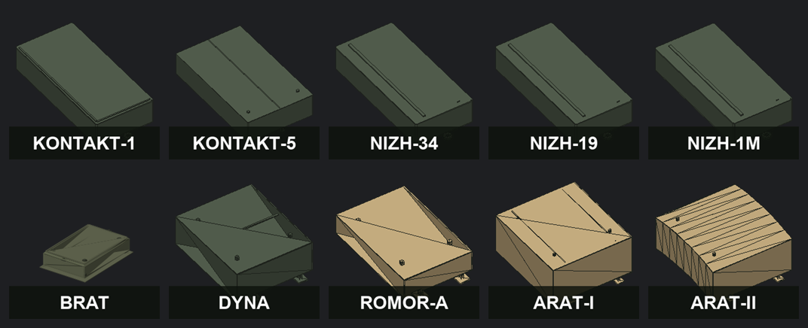
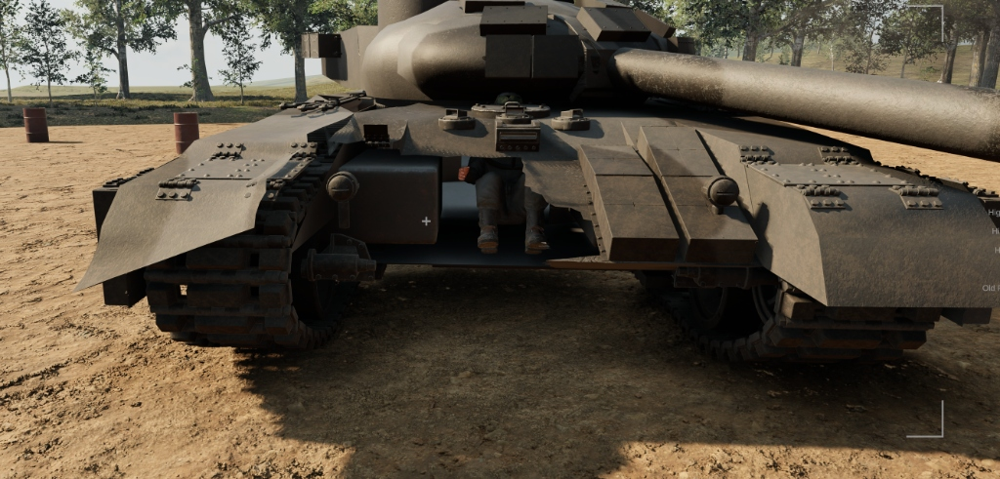
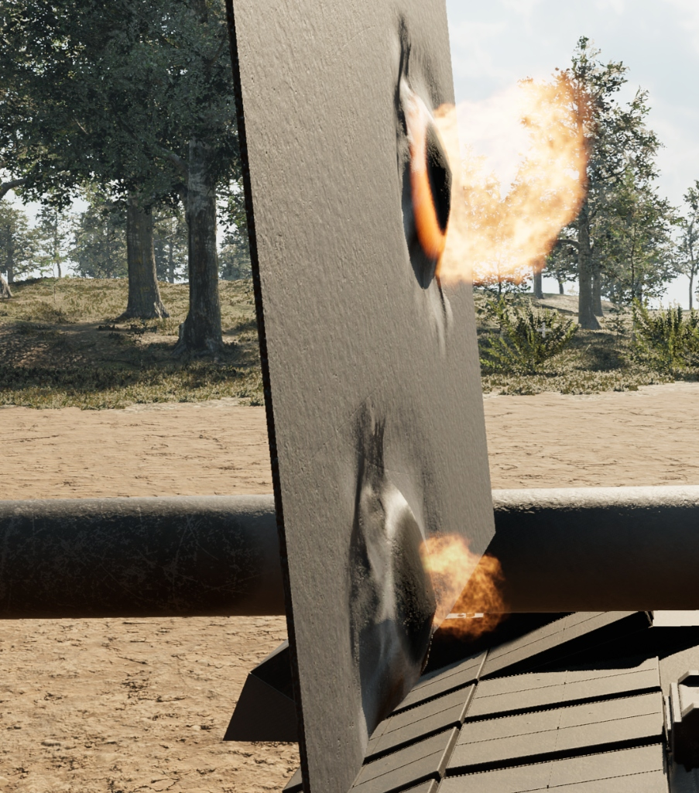
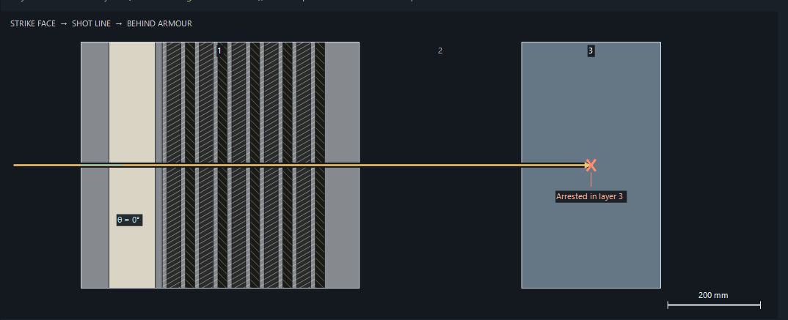
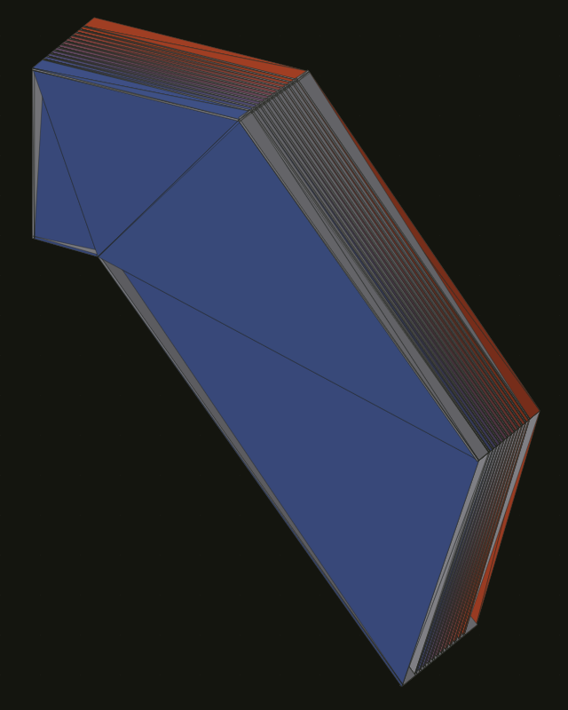
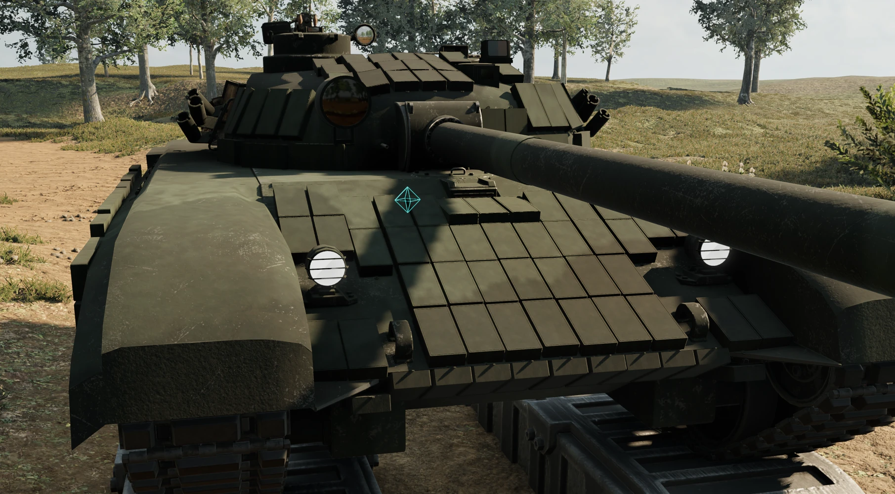
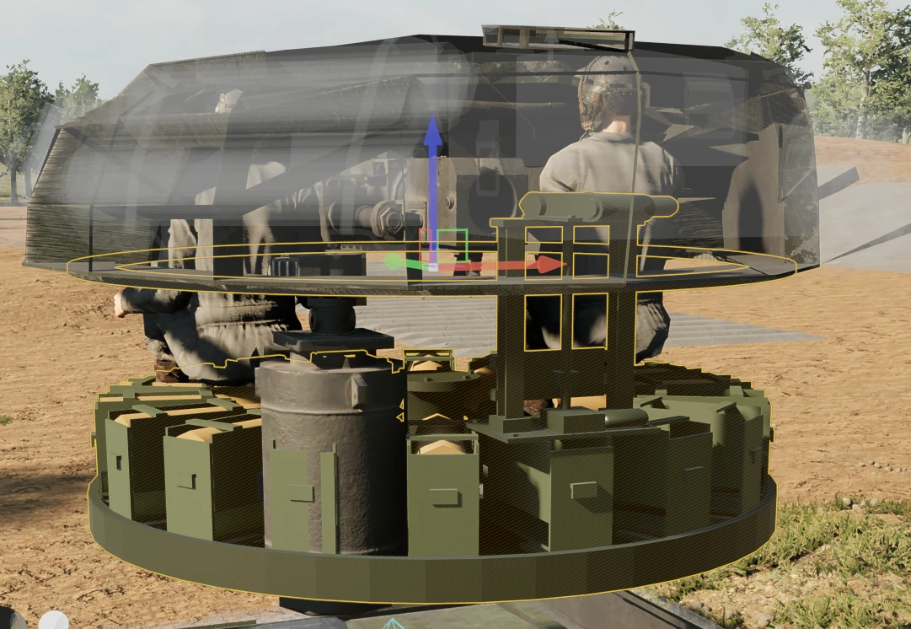
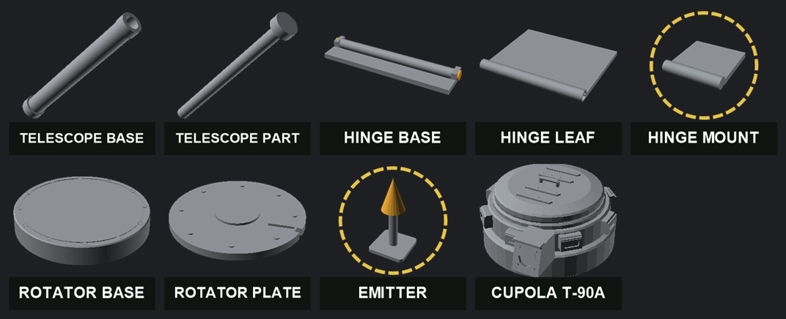
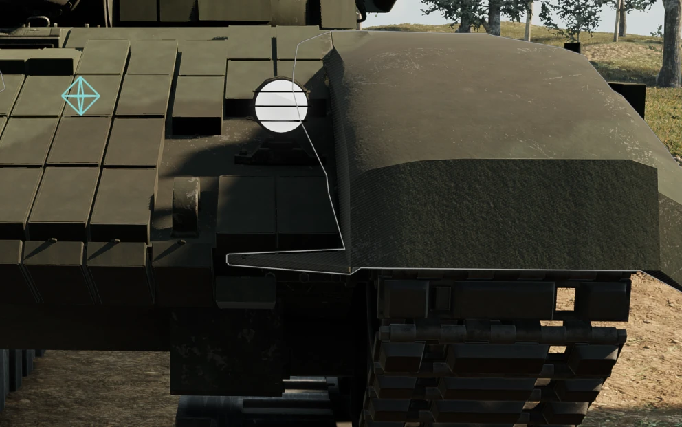

# Sprocket Cold War Pack

A set of mods for the tank game **Sprocket** that brings the Cold War to the tank designer: new eras, realistic armour and ammunition, period sights, night vision, new turret and loader types, and a few handy tools.

The mods work on their own, but they are made to be installed together as one pack.



> Every mod was tested in the game. Each mod has its own page (in the `mods` folder) with what it does and how to use it. If something does not work, please open an issue, tell me what you were doing, and attach the file `BepInEx\LogOutput.log`.

## What is in the pack

### Destructible armour: Plate Destruction

Armour plates, side skirts, and applique panels take real, visible battle damage instead of staying pristine. Heavy HE, HESH, HEAT, and blast hits dent thick steel inward, punch glowing holes clean through plates, and tear open hulls and side skirts — exposing the crew and internals underneath and letting follow-up shots pass straight through the breach.

- **Local thickness & solid torn edges:** damage is calculated per cell from the plate's actual thickness, with solid steel rim walls along tears and holes.
- **Mirrored sides break independently:** losing your right side skirt leaves the left side intact, and destroyed sections are removed from the armour calculation.
- **Inter-plate shielding:** intact outer plates protect the hull or composite blocks behind them until they are breached.





### Armour and ammunition: Expanded Ballistics

The biggest mod in the pack. It changes how shells and armour work, so the way you build a tank starts to matter.

- **Shells of the right age.** Several generations of armour-piercing, high-explosive and hollow-charge shells. Which ones you can use depends on the date of your tank. You can design your own shell, and carry a mix of types that you switch between in battle.
- **Armour you can build up.** Choose materials (steel, composite, ceramics, rubber, wood and more) and stack them in layers to make your own armour packages, or start from presets that follow real tanks.
- **Reactive armour you can place.** Kontakt-1, Kontakt-5, Relikt, Nizh, Duplet, BRAT, ARAT and more. A block protects you once. After it has gone off you can see it on the tank: the cover is blown open. Go back to the designer and start again, and the block is new.
- **Guided missiles.** Place a launcher, a guidance sight and a missile box on your tank. You steer the missile to the target yourself, or let it follow the aim point. Some missiles can also be fired from a gun.
- **See what happened.** After a hit, a report shows a cross-section of your armour with the path of the shell: where it went through, where it stopped, and why.



In the designer you can switch on an overlay that shows the armour layers inside a plate.



<!-- SCREENSHOT: ballistics-shell-editor.png (the shell editor in the cannon inspector) -->
<!-- SCREENSHOT: ballistics-atgm.png (a tank with the missile launcher, guidance sight and missile box) -->


The cassette composer builds armour packages layer by layer and shows how well they protect against each kind of shell.




### Sights and night vision

- **Thermal Sight.** Night-vision sights from the early infrared lamp (1950s), through image intensifiers (1960s), to thermal imaging (1990s). Hot engines and barrels light up. Includes an infrared searchlight and laser rangefinders that help your aim.
- **Gun Sights.** 33 gunner's sights from Germany, the Soviet Union, the United States and the United Kingdom. Each has the right magnification and crosshair for its time. Every sight has a tick box "Sight follows gun", so you can choose whether the view moves with the barrel. Switch it off and you can build Swingfire-style missile carriers.


<!-- SCREENSHOT: gunsight-view.png (looking through one of the gun sights) -->

### Turrets, loaders, suspension and engines

- **Carousel Autoloader.** Four loader types for your tank: bustle, semi-automatic, revolver and belt-fed. There is also a carousel for the turret basket, as in Soviet T-64, T-72 and T-80 tanks. The T-72 style carousel is animated.
- **Oscillating Turret.** A tilting upper turret on a compact gun drive, and a heavy trunnion mount.
- **Hydropneumatic suspension.** Raise, lower and tilt your tank while you drive. Travel, stiffness and damping are set in the designer.
- **Stabilization.** A gun stabiliser for turret drives, with realistic speed limits.
- **Engine Expansion.** Diesel and gas turbine engines, a smaller gearbox, and a power pack that fits engine and gearbox as one block.
- **Smoke Launchers.** A bank of three smoke tubes, fired with one key.



<!-- SCREENSHOT: oscillating-turret.png (a tank with the oscillating turret) -->
<!-- SCREENSHOT: hydropneumatic.png (a tank raised and lowered, or the settings in the designer) -->

<!-- SCREENSHOT: smoke-launchers.png (a tank with the smoke launcher bank) -->

### Camo nets, mudflaps & hinged skirts: Floppy Parts

Turn any plate structure into **camo nets, canvas tarps, rubber mudflaps, or hinged side skirts** that actually move when you drive and fight. Pick a material in the **Floppy Parts** section of the Plate Structure inspector, choose how it moves, and let the tank bring it to life:

- **Cloth, rubber, and hinged motion.** Drape camo netting over a turret or barrel, flex thick rubber mudflaps and side skirts over bumps, or let hinged armour plates swing under gravity (carrying anything attached to them).
- **Reacts to the world.** Plates respond to vehicle movement, wind, nearby muzzle blasts, and engine/vent airflow.
- **Custom looks & pinning.** Choose from Canvas, Camo Net (with alpha cutout and shadows), Rubber, Wood, Glass, or your own PNG textures—with automatic anchor pinning to nearby hull/turret parts or manual edge pinning.

### Mast, hinge and signals

- **Telescopic Mast.** A mast that slides out and back, a hinge (for openable hatches, or a flap that opens when the gun fires) and a turntable.
- **I/O editor.** Connect events such as "gun fired", "brake pressed" or a key to parts on your tank with simple building blocks. Other mods in the pack plug into it.
- **Emitter.** Throws things out of your tank on a signal, for example spent shell casings when the gun fires.
- **Cupolas.** Detailed commander's cupolas (T-90A, T-80BVM, Abrams, Challenger, and Leopard) plus a T-90A driver's hatch.
- **Visual Effects.** Working lamps: lamp parts in any colour that really light up, and that you switch on and off from the I/O editor (for example a brake light). Also muzzle blast and smoke.






<!-- SCREENSHOT: visual-effects.png (muzzle blast and smoke in game) -->

### Orders for your allies

- **AI Orders.** Give quick orders to your AI allies (move, follow, halt, attack, retreat), or plan them on a map.

<!-- SCREENSHOT: ai-orders-map.png (the order panel and the map in a battle) -->

### Eras and shared parts

- **Cold War Expansion Pack.** Adds three new eras: Coldwar1 (from 1945), Coldwar2 (from 1960) and Coldwar3 (from 1975), with the engine and gun technology of their time.
- **Keybinds.** A menu for the keys of all mods, inside the game's own Settings screen.
- **UI Kit** and **JSON Editor** are small helpers that other mods use for their windows and lists. You do not need to do anything with them. Keybinds and UI Kit are also open to other mod makers, see the [framework guide](docs/FRAMEWORK.md).

## The mods

Every mod has a folder in [`mods`](mods) with its own page: what it does, its settings and keys, and what has been tested.

| Mod | Version | In short |
|---|---|---|
| [Expanded Ballistics](mods/ExpandedBallistics) | 0.22.99 | Shells, armour, reactive armour, guided missiles, combat report |
| [Plate Destruction](mods/PlateDestruction) | 0.8.3 | Destructible armour plates, blast dents, holes, and torn edges |
| [Thermal Sight](mods/ThermalSight) | 0.5.4 | Night vision and thermal sights, searchlight, rangefinders |
| [Gun Sights](mods/GunSights) | 0.3.0 | 33 period gunner's sights |
| [Carousel Autoloader](mods/CarouselAutoloader) | 0.3.4 | Bustle, semi, revolver and belt-fed loaders, carousel |
| [Hydropneumatic](mods/Hydropneumatic) | 0.4.4 | Adjustable suspension |
| [Oscillating Turret](mods/OscillatingTurret) | 0.3.1 | Tilting turret and heavy trunnion mount |
| [Stabilization](mods/Stabilization) | 0.7.4 | Gun stabiliser |
| [Engine Expansion](mods/EngineExpansion) | 0.7.3 | Diesel and gas turbine engines, power pack |
| [Smoke Launchers](mods/SmokeLaunchers) | 0.2.5 | Smoke launcher bank |
| [Telescopic Mast](mods/TelescopicMast) | 0.9.9 | Mast, hinge, turntable, signal editor |
| [Emitter](mods/Emitter) | 0.1.3 | Ejected shell casings |
| [Cupolas](mods/Cupolas) | 0.1.0 | Modern commander's cupolas and T-90A driver hatch |
| [Floppy Parts](mods/FloppyParts) | 0.3.4 | Cloth, rubber and hinged plate motion + custom plate materials |
| [Visual Effects](mods/VisualEffects) | 0.5.3 | Muzzle blast, smoke, lamps |
| [AI Orders](mods/AIOrders) | 0.5.4 | Orders and map for AI allies |
| [Cold War Expansion Pack](mods/ColdWarExpansionPack) | 0.2.0 | Three Cold War eras |
| [Keybinds](mods/Keybinds) | 0.1.10 | Key menu for all mods |
| [UI Kit](mods/UiKit) | 0.1.13 | Shared window style |
| [JSON Editor](mods/JsonEditor) | 0.1.5 | Shared list editor |

Some mods need others to work: Thermal Sight, Hydropneumatic, Smoke Launchers, Telescopic Mast and AI Orders need Keybinds. Expanded Ballistics, Telescopic Mast and AI Orders need UI Kit, and Expanded Ballistics also needs JSON Editor. Install the whole pack and you do not have to think about this.

## How to install

1. **Install the mod loader.** The pack runs on BepInEx 6. Use the **Sprocket Mod Loader** by Hans21223, which installs the right BepInEx version with a fix for Sprocket: <https://github.com/Hans21223/Sprocket-Mod-Loader>. The "Easy install" with the Mod Manager is the simplest way. It is a separate project and not part of this pack. Start the game once afterwards, so it can set itself up. The first start takes a while.
2. **Install the pack.** Download `SprocketColdWarPack-v1.2.0.zip` from the [Releases](../../releases) page and extract it into the Sprocket game folder (the folder with `Sprocket.exe`). Merge it with the existing `BepInEx` and `Sprocket_Data` folders.
3. **Start the game.** Settings are in the folder `BepInEx\config`. They are created at the first start. The mods that need keys do not choose them for you: set your own in the game's Settings screen, under Controls.

To remove a mod, delete its `SprocketXxx` folder in `BepInEx\plugins`. If you update by extracting a newer zip over an older one, your edited settings files are overwritten, so keep a copy.

### Upgrading from older standalone versions

The internal storage keys were renamed when the mods were bundled into this pack. Saved `.blueprint` vehicles made with older standalone versions will still load, but their mod-specific settings (chosen shells, autoloader setup, hydropneumatic suspension, telescopic mast/hinge data, and thermal sight profiles) will reset to defaults unless you convert them first.

Use [`tools/Convert-OldModBlueprints.ps1`](tools/Convert-OldModBlueprints.ps1) on Windows (PowerShell, no Python required) to update your saved blueprints in `Documents\My Games\Sprocket`:

```powershell
# Preview which blueprints will be updated (dry run, changes nothing):
.\tools\Convert-OldModBlueprints.ps1

# Convert them (automatically creates a backup folder first):
.\tools\Convert-OldModBlueprints.ps1 -Apply
```

## For mod makers

The source of every mod is in [`mods`](mods), with the scripts and data it was made from. Building needs the interface files that BepInEx generates for your copy of the game, so the finished plugins are only in the releases. Build Keybinds, UI Kit, JSON Editor and Telescopic Mast first, because other plugins build on them.

## Credits and licence

Made by Nero. All rights reserved (see [LICENSE](LICENSE)), except for [Keybinds](mods/Keybinds) and [UI Kit](mods/UiKit), which remain under the MIT licence.

Built on [BepInEx](https://github.com/BepInEx/BepInEx) and [Harmony](https://github.com/pardeike/Harmony), and run through Hans21223's [Sprocket Mod Loader](https://github.com/Hans21223/Sprocket-Mod-Loader). The sounds in Carousel Autoloader and Expanded Ballistics were made by the author. Expanded Ballistics uses a particle texture by Kenney (CC0, see [`mods/ExpandedBallistics/vfx/KENNEY-LICENSE.txt`](mods/ExpandedBallistics/vfx/KENNEY-LICENSE.txt)).
