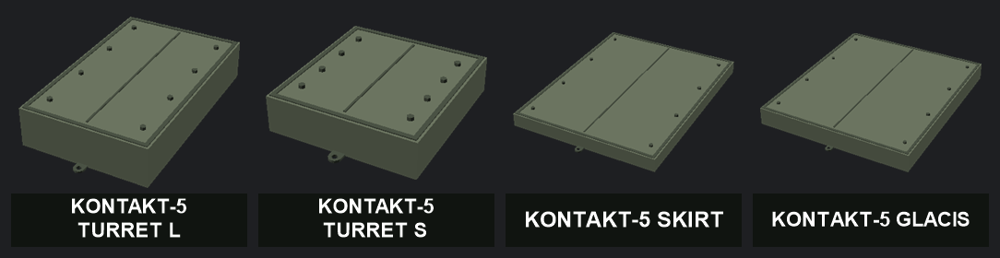
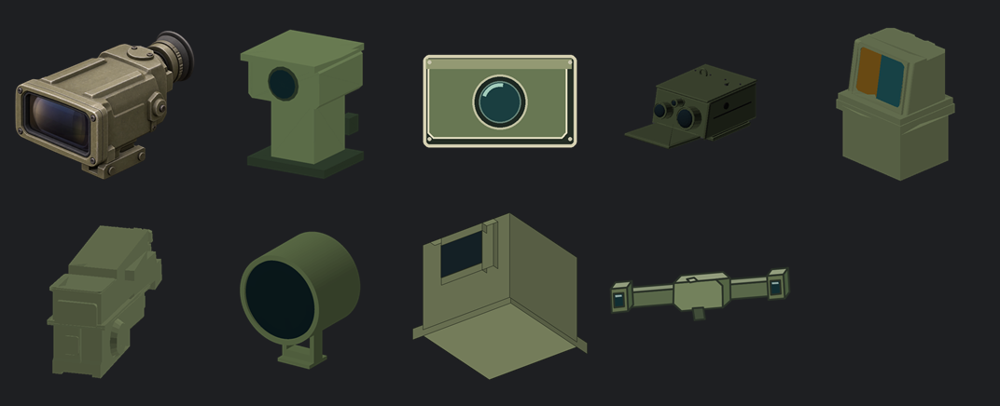

# Sprocket Cold War Pack

A Cold War-era expansion for the tank game Sprocket: armour and ammunition, sights and optics, turrets and suspension, a telescopic mast with a signal editor, and a small campaign mode. It is one pack of BepInEx plugins that are meant to be installed together.

**Status: pre-release (v1.0.0).** Most mods in the pack were tested in the game one by one, at earlier versions. This renamed, combined release has not been tested end to end in the game yet, and several newer features have no in-game result at all. Each mod's README says what was and was not tested. Expect rough edges and please report them.

Tested with Sprocket 0.2.56.2 and BepInEx 6.0.0-be.788 (installed through the Sprocket Mod Loader, see Installation) on Windows (x64).

## Highlights

### Armour and ammunition

- **Dated shell profiles.** APFSDS (several generations), APCR, APDS, APCBC, APHE, HE, HEAT, tandem HEAT and HESH, chosen by the vehicle date. A shell editor in the cannon inspector lets you define your own, and you can carry a mix of shell types and switch between them in battle.
- **Guided ATGMs.** SACLOS and MCLOS missiles, a top-attack profile and gun-launched missiles, with a placeable launcher, a gimbal guidance sight and a finite ammunition box.
- **Placeable ERA.** Kontakt-1, Kontakt-5 (with four size variants), Relikt, Nizh, Duplet, BRAT, ARAT and ROMOR-A. A cell reacts once and is rearmed on the next Edit/Play cycle, and a spent housing shows its open state.
- **Armour materials and a cassette composer.** A material editor with extra materials (wood, rubber, fabric, glass, ceramics) and layered passive and reactive armour packages, including presets modelled on named vehicles.
- **Combat report.** The latest impacts with a cross-section drawing per hit ("Forensic"), an optional damage feed, and the last session saved as HTML and JSON.

### Sights and optics

- **Thermal Sight.** Dated sensor profiles from active infrared (1950) and image intensifier (1962) to thermal Gen 2 (1992), a per-vehicle heat model, an IR searchlight and manual and automatic laser rangefinders. Range readings can correct the aim for bullet drop.
- **Gun Sights.** 33 period gunner's sights for Germany, the Soviet Union, the United States and the United Kingdom, each with its own start date, true optical powers and reticles drawn at true angular size.

### Turrets, loaders, suspension and engines

- **Carousel Autoloader.** Bustle, semi-autoloader and revolver parts, plus a carousel option for turret baskets in T-72 and T-64/T-80 style, with a turning ring, a lift, optional two-piece ammunition and a crew loader.
- **Hydropneumatic suspension.** Raise, lower and pitch the tank while driving, with editor sliders for travel, firmness and damping.
- **Oscillating Turret.** An oscillating upper turret on a compact elevation drive, and a Heavy Trunnion Mount.
- **Stabilization.** A stabilizer option for turret drives with rate limits that default to realistic values.
- **Engine Expansion.** Diesel and gas turbine engines, a smaller transmission and a Powerpack option that fits engine and gearbox as one block.
- **Smoke Launchers.** A three-tube launcher bank, fired with one key.

### Mast, hinge, rotator and I/O flow

- **Telescopic Mast.** A retractable mast, a hinge (for example a shell-ejector flap that opens when the cannon fires) and a rotator turntable.
- **I/O Flow editor (F8).** Wire cannon, braking, key and mast signals through AND, OR, NOT, delay, pulse, counter and memory blocks to parts. Other mods add inputs, outputs and part settings through the I/O API.
- **Emitter** throws spent casings out of the vehicle, **Cupolas** adds a detailed T-90A-style commander cupola, and **Visual Effects** adds volumetric muzzle blast and smoke plus RGB lamp parts that can be switched from the flow.

### Campaign, tools and shared libraries

- **Expedition.** A campaign run through the installed eras: fight cards, boss fights, items, an era schedule and enemy AI, with a soundtrack per phase.
- **AI Orders.** Quick orders (F9) and a tactical map (M) for your AI allies.
- **Sandbox Targets** adds target tanks at set distances to the flat-map sandbox, and **Reference Images** puts a reference picture on a board part in the designer.
- **Keybinds, UI Kit and JSON Editor** are shared libraries: a keybind menu inside the Settings screen, a common window style with charts, and an editor for JSON entry lists.
- **Cold War Expansion Pack** (the core) adds the three Cold War eras (Coldwar1 from 1945.09.04, Coldwar2 from 1960 and Coldwar3 from 1975) and its engine and cannon technology data. The game's own Coldwar placeholder is left as it is.

## Mods in this pack

Every mod has its own folder under [`mods/`](mods) with a README (features, settings, keys, test status, build notes). "Needs" lists hard dependencies only; a mod that is missing one does not load. Optional partners are named in each mod's README.

| Mod | Version | What it does | Needs |
|---|---|---|---|
| [Expanded Ballistics](mods/ExpandedBallistics) | 0.22.77 | Dated shell profiles, guided ATGMs, armour materials with placeable ERA, cassette composer, combat report | JSON Editor, UI Kit |
| [Thermal Sight](mods/ThermalSight) | 0.4.0 | Thermal, image intensifier and active IR sights, IR searchlight, laser rangefinders | Keybinds |
| [Gun Sights](mods/GunSights) | 0.2.4 | 33 period gunner's sights with true optics and reticles | |
| [Carousel Autoloader](mods/CarouselAutoloader) | 0.2.34 | Bustle, semi and revolver autoloaders, carousel basket | |
| [Hydropneumatic](mods/Hydropneumatic) | 0.4.4 | Adjustable hydropneumatic suspension | Keybinds |
| [Oscillating Turret](mods/OscillatingTurret) | 0.3.1 | Oscillating upper turret and Heavy Trunnion Mount | |
| [Stabilization](mods/Stabilization) | 0.7.3 | Stabilizer option for turret drives | |
| [Engine Expansion](mods/EngineExpansion) | 0.5.0 | Diesel and gas turbine engines, smaller transmission, Powerpack | |
| [Smoke Launchers](mods/SmokeLaunchers) | 0.2.5-datums.2 | Three-tube smoke launcher bank | Keybinds |
| [Telescopic Mast](mods/TelescopicMast) | 0.9.9 | Mast, hinge and rotator parts, I/O Flow editor and I/O API | Keybinds, UI Kit |
| [Emitter](mods/Emitter) | 0.1.1 | Cosmetic casing emitter driven by the I/O Flow | |
| [Cupolas](mods/Cupolas) | 0.1.0 | Detailed T-90A-style commander cupola | |
| [Visual Effects](mods/VisualEffects) | 0.4.5 | Volumetric muzzle blast, smoke and dust, RGB lamp parts | |
| [Expedition](mods/Expedition) | 0.3.12 | Campaign mode with fight cards, bosses and enemy AI | UI Kit |
| [AI Orders](mods/AIOrders) | 0.5.2 | Quick orders and a tactical map for AI allies | UI Kit, Keybinds |
| [Sandbox Targets](mods/SandboxTargets) | 0.3.2 | Extra target tanks in the flat-map sandbox | |
| [Reference Images](mods/ReferenceImages) | 0.1.2 | Reference picture board part for the designer | UI Kit, Keybinds |
| [Cold War Expansion Pack](mods/ColdWarExpansionPack) | 0.2.0 | Coldwar1, Coldwar2 and Coldwar3 eras, engine and cannon technology data | |
| [Keybinds](mods/Keybinds) | 0.1.9 | Shared keybind menu in the Settings screen | |
| [UI Kit](mods/UiKit) | 0.1.12 | Shared panel library | Keybinds |
| [JSON Editor](mods/JsonEditor) | 0.1.5 | Shared in-game JSON list editor | |

The pack has its own version (1.0.0); the mods keep the versions shown above. Install the whole pack: the mods share Keybinds, UI Kit and the Telescopic Mast, and some of the data they ship (for example the Coldwar eras) is used by several mods.

## Installation

1. **Install the mod loader.** The pack runs on BepInEx 6 (IL2CPP). The official BepInEx can hang on a black screen with current Sprocket builds, so use the **Sprocket Mod Loader** by Hans21223, which installs the official BepInEx build `6.0.0-be.788` together with a compatibility patch: <https://github.com/Hans21223/Sprocket-Mod-Loader> (see its Releases page; the "Easy install" with the Mod Manager is the simplest way, and its README also describes a manual install). It is a separate project and is not part of this pack. You only need the BepInEx part, not MLLoader. Start the game once after installing it, so that BepInEx creates its folders; the first start takes a while.
2. **Install the pack.** Download `SprocketColdWarPack-v1.0.0.zip` from the Releases page of this repository and extract it into the same folder, merging it with the existing `BepInEx` and `Sprocket_Data` folders. The zip only contains files for those two folders.
3. **Start the game.** Settings are in `BepInEx\config\sprocket.<modname>.cfg` (some mods use a `.json` file, see their README) and are created at the first start. Key bindings are set in Sprocket's Settings screen (Controls), in the mod keybinds panel that Keybinds adds.

To remove a mod, delete its folder `SprocketXxx` from `BepInEx\plugins`. The release also has a file list (`SprocketColdWarPack-v1.0.0-files.txt`) if you want to remove everything the pack installed. When you update by extracting a newer zip over an older one, files you edited (for example `.cfg` files) are overwritten; keep a copy of them.

## Building from source

The folders under `mods/` hold the source of each plugin (C#, .NET), together with the scripts, OpenSCAD files and data they were made from. Building needs the interop assemblies that BepInEx generates for your copy of the game, which is why compiled plugins are only shipped in the releases and not in the repository. A few mods embed audio or mesh files that are not part of the repository; their README says which. Build `mods/Keybinds`, `mods/UiKit`, `mods/JsonEditor` and `mods/TelescopicMast` first, because other plugins build against them.

## Credits and licence

Author: Nero. The code in this repository is released under the MIT licence (see [LICENSE](LICENSE)).

Built on [BepInEx](https://github.com/BepInEx/BepInEx) and [Harmony](https://github.com/pardeike/Harmony), and run through Hans21223's [Sprocket Mod Loader](https://github.com/Hans21223/Sprocket-Mod-Loader). Expedition adapts a method from Hans21223's Sprocket Battle Editor (MIT; see [`mods/Expedition/THIRD-PARTY-NOTICES.md`](mods/Expedition/THIRD-PARTY-NOTICES.md)). The Expedition soundtrack (six tracks) and the sounds embedded in Carousel Autoloader and Expanded Ballistics were created by the author with his own Suno account. Expanded Ballistics uses a particle texture set by Kenney (CC0, see [`mods/ExpandedBallistics/vfx/KENNEY-LICENSE.txt`](mods/ExpandedBallistics/vfx/KENNEY-LICENSE.txt)).
