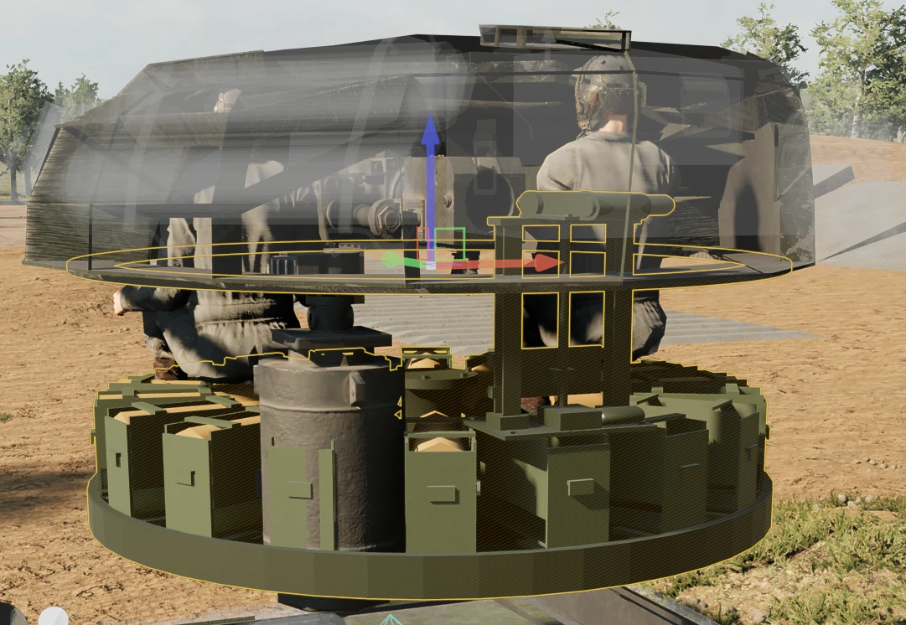

# Sprocket Carousel Autoloader

Carousel Autoloader adds dated autoloader mechanisms to Sprocket: a bustle, a semi-autoloader, a revolver and a belt feed, plus a carousel for the turret basket. Each one feeds a cannon from a limited store of rounds and has its own model, sound and display.

- Version: 0.3.4
- Needs: no other mod
- Works better with: Sprocket UI Kit for the display, and Sprocket Expanded Ballistics for mixed ammunition, round sizes and the display position under its AMMO panel
- Game version tested: 0.2.56.2

## What it adds

- Bustle autoloader (from 1952.01.01). It holds a limited ready magazine, and an assigned crew loader refills it from the normal racks after it is empty.
- Semi-autoloader (from 1953.01.01). It helps a crew loader mechanically and needs a healthy crew loader.
- Revolver autoloader (from 1952.01.01). A two-drum loader in the style of the AMX-13, with fast fire from one drum. A crew loader refills it, also while driving. Without a loader the drum refills round by round, but only while the vehicle stands still.
- Belt feed box (from 1965.01.01). A rack for belted ammunition that fires at a rate set by the calibre. A crew loader refills it from the reserve racks while the vehicle stands still.
- Carousel for the turret basket, in the T-72 style (from 1973.01.01) or the T-64 and T-80 style (from 1967.01.01), as used in Soviet tanks.
- Optional two-piece ammunition for the bustle and revolver. Projectile and charge are stored separately, which makes the cycle 1.25 times longer.
- Own models with rounds at their true size, in cassettes, chains and drums. The carousel ring turns one slot per shot, and a cassette lift sits behind the breech.
- Ammunition in the carousel basket can cook off through the game's damage model (can be switched off).
- Own reload sounds, and a small display of stock, fire cycle and refill that only shows while a loader is working.

## How to use it

1. Open the vehicle designer and place a cannon in the turret.
2. For a bustle, semi-autoloader, revolver or belt feed, find the loader in the parts list and attach it behind the gun. Parts that are too early for the vehicle's date or too large for the gun do no work. They keep their place, and one warning is written to the log.
<!-- SCREENSHOT: carousel-parts-list.png (the four loader parts in the designer parts list) -->
3. Assign a crew loader to the loader. The bustle, semi-autoloader, revolver and belt feed all depend on a healthy crew loader to refill them. Put ordinary ammunition racks within reach, because the loaders fill up from the normal racks. For the belt feed, the reserve rounds are picked by their native projectile size and type.
4. For the bustle and revolver, tick the option for two-piece ammunition in the part inspector if you want projectile and charge stored separately.
5. For a carousel, select the turret basket and choose the T-72 style or the T-64 and T-80 style in its inspector. The inspector enforces the dates.

The T-72 style carousel is animated: the ring turns and the rounds move as the gun loads.
6. Start a test drive or a battle. Fire the gun and watch the loader work. The display appears under the AMMO panel and shows how many rounds are left and what the loader is doing. A belt feed shows the number of rounds on the left and a coloured status on the right: green when it fires or is full, yellow when it refills, orange when it is empty, the vehicle is moving or no loader is assigned.

## Settings

The settings file is `BepInEx\config\sprocket.carousel.cfg`. The game creates it on the first start. The mod has no keys. You set up the loaders in the part and basket inspectors of the vehicle editor.

| Section / key | Default | What it does |
|---|---|---|
| `Visuals / OwnRounds` | `true` | Uses rounds at true size instead of the native ammunition grid. |
| `Visuals / CarouselModel` | `Detailed` | `Detailed` or `Simple` carousel model. A basket that is too small for the detailed model gets the simple one. |
| `Visuals / CarouselTurnSeconds` | `0.5` | Seconds the ring takes to turn one slot. 0 makes it jump. |
| `Visuals / CarouselLift` | `true` | Shows the cassette lift behind the slots. |
| `Bustle / MaxFeedDistance` | `0` | Reach of the feed arm in metres. 0 means the native reach of a crew member's hand. |
| `Revolver / MaxCaliberMm` | `155` | The largest calibre the drum accepts. |
| `Revolver / MaxRoundLengthMm` | `0` | The longest round in mm. 0 means no fixed limit. |
| `Revolver / CycleFactor` | `0.6` | Fire cycle of the revolver as a multiple of the bustle cycle. |
| `Belt / Enabled` | `true` | Turns the belt feed box on. |
| `Belt / MaxCalibre` | `57` | The largest round diameter in mm the belt accepts. |
| `Belt / RpmByCalibre` | `9:750,15:550,23:900,30:200,40:150,57:120` | Rounds per minute per calibre, as pairs of calibre in mm and rate. |
| `Belt / MaxFeedDistance` | `1.5` | Largest distance in metres from the box to the breech. |
| `Belt / BoxMassKg` | `25` | Mass of the box without ammunition. |
| `Belt / RefillSecondsPerRound` | `1` | Seconds the crew needs per round when refilling. |
| `Belt / StationarySeconds` | `3` | Seconds of standing still before refilling is allowed. |
| `Damage / NativeCookoff` | `true` | `false` switches off the mod's own cook-off for basket ammunition. |
| `Audio / Enabled` | `true` | Own reload sounds. They only run on the Unity version they were made for (6000.3.21f1). |
| `Hud / Enabled`, `Hud / Placement` | `true`, `BelowAmmo` | Display on or off, and `BelowAmmo` or `Manual` placement. |
| `Diagnostics / DetailedLogging` | `false` | Extra lines in the log file for troubleshooting. |

More entries (`RefillCycleFactor`, `MinimumRefillSeconds` and the display offsets) are in the file with descriptions. The four part definitions (`sprocketBeltAutoloaderPart.json`, `sprocketBustleAutoloaderPart.json`, `sprocketRevolverAutoloaderPart.json`, `sprocketSemiAutoloaderPart.json`) are in `Sprocket_Data\StreamingAssets\Parts`, and the plugin folder is `BepInEx\plugins\SprocketCarouselAutoloader\`.

## Known limits

- Version 0.3.3 is installed and loads without errors. The checks of the belt feed in the game are still open: the status card, its six states and its colours, and the card next to the bustle and revolver cards.
- In the test of 0.3.1 a loader that was assigned did not refill. The cause was a reserve rack of another slot, and 0.3.2 changed how reserve rounds are picked. This has not been checked in the game yet, nor has the own belt model at different fill levels. When Expanded Ballistics manages the ammunition mix, it can still exclude racks of another slot. Refilling then only works when the cannon has no managed mix or the reserve rack has the same slot as the cannon.
- The bustle refills only when it is empty. This is intended.
- Not yet checked in the game: the refill of the bustle and revolver, two-piece ammunition, the limits of the revolver, and the lift position fix for baskets 1193 to 1216 mm deep.
- Seen working earlier: the display, the T-80 style carousel model and the lift position. The turn of the ring was confirmed in the log but not yet by eye.
- A report that a vehicle vanished after a carousel basket exploded (2026-11-12) is still under investigation. `Damage / NativeCookoff = false` switches off the mod's cook-off.
- The renamed pack as a whole has not been re-tested in the game yet.

## Building

The source is a .NET project in this folder (`SprocketCarouselAutoloader.csproj`, net6.0). Build it with `dotnet build SprocketCarouselAutoloader.csproj -c Release -p:GameDir=<path to Sprocket folder>`. The UI Kit DLL is taken from `$(GameDir)\BepInEx\plugins\SprocketUiKit` or from `-p:UiKitDll=<path>`. The three reload sound files (`Assets\Audio\t90.wav`, `t64.wav`, `bustle.wav`) are embedded by the project but are not in this folder. They ship with the release only. The author made the three sounds with his own Suno account.

Release notes: [CHANGELOG.md](CHANGELOG.md). Tests: `dotnet run --project tests\Carousel.Tests.csproj -c Release`. The bustle and revolver meshes come from the OpenSCAD sources in `Models\scad`, and the two carousel models are `Models\carousel_t72.obj` and `carousel_t80.obj`.
