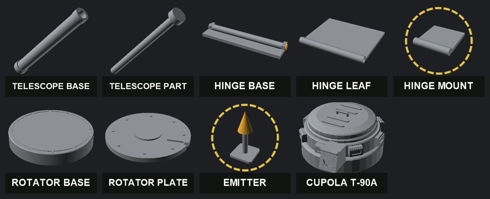

# Sprocket Cupolas

Cupolas adds a commander's cupola in the style of the T-90A (not an exact copy) to the tank designer. It keeps the game's own commander, viewport and cook-off behaviour and replaces only what you see.

- Version: 0.1.0
- Plugin GUID: `sprocket.cupolas`
- Needs: no other mod
- Works together with: Sprocket Telescopic Mast, which is used only to show the part icon. Without it the game's fallback icon appears and the part works as usual.
- Game version tested: 0.2.56.2

## What it adds

- One part, "Cupola T-90A", in the cupola category (tags cupola, commander, ussr), available from part date 1992.01.01. Scale 0.5 to 2.
- A detailed ring, about 0.67 m across at scale 1, with a sight head that sticks out, and a separate lid. The lid is a fixed model and does not open or close.
- The commander, the viewport and the cook-off work as in the game's own German cupola, which this part is built on. A cook-off may hide the lid.
- Collision, damage and mass stay those of the stock cupola (0 kg, 0 model cost). The visible ring is no extra armour.

## How to use it

1. Open the part list in the designer and choose the cupola category.
2. Select "Cupola T-90A" and place it on the turret roof, as you would the stock cupola.
3. Scale it between 0.5 and 2 if needed and paint it like any other part. Ghost previews while you place it still show the stock shape. The new shape appears once the part is placed.
4. Mirroring on the centre line of the vehicle is one of the points that still has to be checked in game (see Known limits).

<!-- SCREENSHOT: cupola-designer.png (the Cupola T-90A placed on a turret in the designer) -->
<!-- SCREENSHOT: cupola-closeup.png (a close-up of the ring, the sight head and the lid) -->

If the vehicle layout is unclear or the paint atlas cannot be read, the mod keeps the stock cupola and writes the reason in the log.

## Settings

The settings file is `BepInEx\config\sprocket.cupolas.cfg`. It is shipped with the mod, so do not overwrite an existing file when you copy the pack. It has one entry: `Diagnostics.DetailedLogging`, false by default. Set it to true for a more detailed log.

The mod has no keys, no windows and no saved data of its own.

## Known limits

- The cupola was installed on 2026-11-11, but no in-game test result has been recorded.
- Still to check in game: placement and selection in the designer, camo paint, all zoom levels, mirroring on the centre line, a test drive and the return to the designer, saving and reloading, and the stock mass and cost.
- The lid is a fixed model and does not move.
- The pack was renamed and has not been re-tested in game since.

## Building

A .NET project in this folder (`SprocketCupolas.csproj`, net6.0). It builds against the game's interop assemblies: `dotnet build -c Release -p:GameDir=<path to Sprocket folder>`. `Verify.ps1` runs the offline checks, and `Build-Package.ps1 -Out <empty folder>` stages the shipped files in the game folder layout. The models and the icon were made with OpenSCAD, and the sources are in `Assets/approved`. The STL exports are not in the repository; the OBJ files and OpenSCAD sources are.

Docs: [GUIDE.md](GUIDE.md) (developer notes), [CHANGELOG.md](CHANGELOG.md), [GEOMETRY-AND-EVIDENCE.md](GEOMETRY-AND-EVIDENCE.md), [LIVE-ACCEPTANCE.md](LIVE-ACCEPTANCE.md). Licence: MIT (see the repository LICENSE). Author: Nero.
