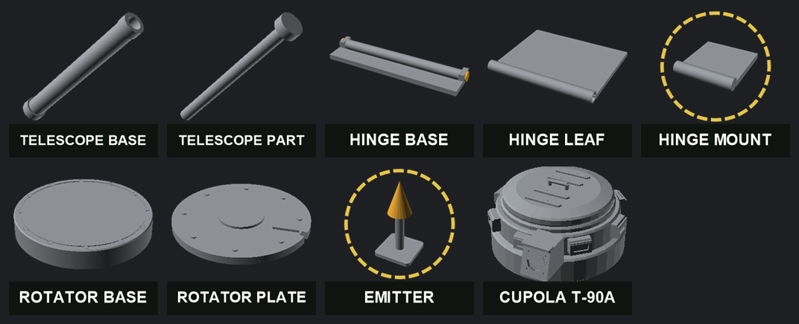

# Sprocket Emitter

Emitter adds a part that throws objects out of your tank when it gets a signal, for example spent shell casings each time the gun fires. The objects are purely visual: no damage, no force on the tank and no sound.

- Version: 0.1.3
- Plugin GUID: `sprocket.emitter`
- Needs: Sprocket Telescopic Mast (0.9.9 or later for the per-part settings). Without it the Emitter does nothing, and the game still starts normally.
- Game version tested: 0.2.56.2

## What it adds

- One part, "Emitter", in Crew / Stowage, available from part date 1930.01.01. In the designer it looks like an arrow (scale 0.5 to 3), and it is hidden in Play. It cannot be mirrored, so place a separate copy on each side.
- An "Eject / Stop" output in the Telescopic Mast's I/O Flow editor. A rising signal throws one batch. With "Repeat while on" the Emitter keeps throwing at an interval until the signal ends.
- Casings and projectiles that use the game's own ammunition models, taken from an ammunition rack that is loaded. They take the rack's material too, and by default they follow the caliber of the biggest gun on your tank.
- Objects that fly a short way, land on the tank or the ground, ride along with a moving surface, slide off slopes steeper than 35 degrees and vanish after their lifetime.

## How to use it

1. Place the Emitter where the objects should leave the tank, for example next to the breech or at an ejection port. The arrow points in the direction they fly.
2. Open the I/O Flow editor from the Telescopic Mast. The editor is opened with the action "I/O Flow / Open panel". If you have not set a key for it yet, go to the game's Settings screen, then Controls, then the mod keybinds panel, and choose one.
3. The Emitter is listed as an output ("Eject / Stop"). Click it to place its block on the canvas.
4. Wire a signal to it. For spent casings, wire the "Cannon fired" input to the Emitter block.
5. Select the Emitter block and open the Settings section in the inspector on the right. Choose the item, the speed and the spread.
6. Save the tank and start a test drive. Each shot now throws a casing.

<!-- SCREENSHOT: emitter-flow.png (the I/O Flow editor with Cannon fired wired to an Emitter block) -->
<!-- SCREENSHOT: emitter-settings.png (the Settings section of the Emitter block in the inspector) -->
<!-- SCREENSHOT: emitter-casings.png (casings lying on the tank and the ground after a few shots) -->

## Settings

Per-part settings are in the I/O Flow inspector, under Settings, for each Emitter block:

- Item: casing or projectile.
- Caliber, 5 to 155 mm. "Follow gun caliber" is on by default and takes the size from the biggest gun on the tank. Switch it off to set a caliber by hand.
- Ejection speed 0.5 to 15 m/s, spread 0 to 30 degrees, spin 0 to 720 degrees per second, and count 1 to 8 per batch.
- Repeat, interval, lifetime, and whether the objects inherit the speed of the vehicle.

The config file `BepInEx\config\sprocket.emitter.cfg` is written at the first start:

- `Meshes.AllowEmbeddedFallback` is false by default. If it is true and no ammunition rack model is found, a simple built-in shape is used.
- `Limits.MaxObjects` is 64 by default (the most objects at one time), `Limits.MaxCastsPerFrame` is 512 and `Limits.MaxLifetime` is 60 seconds.
- `Slope.MaxDegrees` is 35 and `Slope.Friction` is 0.65.
- `Diagnostics.DetailedLogging` is false by default. Set it to true for a more detailed log.

The `Defaults` section in the config only applies with a Telescopic Mast older than 0.9.9.

The Emitter has no keys of its own. Where a key is needed, for example to open the editor, set it in the game's Settings screen, under Controls, in the mod keybinds panel.

## Known limits

- Version 0.1.0 was tested in game (2026-11-13): the Mast link, the per-part settings, throwing, landing and cleanup worked. The casings then used the built-in fallback shape, which looked poor.
- Version 0.1.3 (game ammunition models, rack material, follow gun caliber) is installed and not yet tested in game. Saving, loading and copying a tank with an Emitter, performance, and the hidden arrow in the first moment of Play are also untested.
- If no ammunition rack model has been loaded, nothing is thrown and a warning appears in the log.
- The part description still mentions fire and smoke. Those are not built yet.
- The pack was renamed and has not been re-tested in game since.

## Building

A .NET project in this folder (`SprocketEmitter.csproj`, net6.0, warnings as errors). It builds against the game's interop assemblies: `dotnet build -c Release -p:GameDir=<path to Sprocket folder>`. `Verify.ps1` builds and runs the offline checks in `checks/`.

Docs: [GUIDE.md](GUIDE.md) (developer notes), [ASSET-PROVENANCE.md](ASSET-PROVENANCE.md). Licence: All rights reserved (see the repository LICENSE). Author: Nero.
