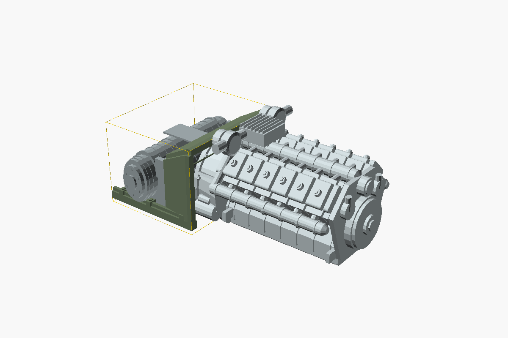

# Sprocket Engine Expansion

Engine Expansion adds diesel and gas turbine engines, each with its own availability date, and a gearbox that takes up half the space. It also adds a Powerpack option that fits engine and gearbox together as one block, with models in the style of MTU and Renk.

Version 0.7.3. It needs no other mod.

## What it adds

- An engine type dropdown in the engine inspector: Petrol (the game's own engine), Diesel and Gas turbine. Each type changes power, RPM range, fuel use, mass and cost compared with the native engine.
- Availability by vehicle date: petrol from 28 July 1914, diesel from 1 January 1935, gas turbine from 1 January 1967. A type that is too early for your tank is labelled and cannot be picked. In the last era, everything is available.
- A smaller gearbox: the volume is halved while rated torque, mass and cost stay the same. The limit on the angle of the driveshaft connection is doubled.
- A Powerpack tick box on the engine. The gearbox is placed against the engine automatically and the connection needs no shaft. Both a single gearbox and a twin layout (a splitter with two mirrored gearboxes) work.
- The Powerpack housing adds engine mass (10 %) and cost (15 %). By default the option is available from 1 January 1965, which is a provisional date.
- Chains of junctions between engine and gearbox are removed in the same step when the gearbox sits within 1.75 m of the engine output. On a set of 154 test blueprints, this raised the number of tanks that qualify from 57 to 123.
- Engine and gearbox models in the MTU and Renk style, made for this mod, with a casing over the seam that is only drawn and does not collide. The collision shape of the parts stays native, with 1 mm of clearance.

## How to use it

1. Open the tank designer and place an engine. Select it to open the engine inspector.
2. Open the engine type dropdown and pick Diesel or Gas turbine. Types that are too early for the date of your tank are greyed out and labelled.
<!-- SCREENSHOT: engine-type-dropdown.png (the engine inspector with the engine type dropdown open) -->
3. To fit engine and gearbox as one block, first connect the engine output to a transmission (or to a splitter feeding two gearboxes) and set the vehicle date to `1965-01-01` or later. Then tick **Powerpack** in the engine inspector (below the engine settings). The gearbox moves against the engine automatically. One undo step takes the change back, and unticking the box restores a normal shaft.

<!-- SCREENSHOT: powerpack-twin.png (a Powerpack with the twin layout) -->
4. Save the tank as usual. The choice is stored in the blueprint.

## Settings

The settings file is `BepInEx\config\sprocket.engineexpansion.cfg`. The game creates it at the first start, and every entry has a description. Restart the game after you change a value.

| Setting | Default | What it does |
|---|---|---|
| `Diagnostics` / `DetailedLogging` | false | Writes extra lines to the log. Warnings and errors are always logged. |
| `Drivetrain` / `TransmissionVolumeMultiplier` | 0.5 | Gearbox volume. |
| `Drivetrain` / `DriveshaftAngleMultiplier` | 2 | Limit on the driveshaft connection angle. |
| `Drivetrain` / `RepairInvalidShiftRPM` | true | Repairs a stored shift RPM that is out of range. |
| `Powerpack` / `AvailableFrom` | 1965.01.01 | First date for the Powerpack option. |
| `Powerpack` / `HousingMassFraction` | 0.10 | Extra engine mass from the housing. |
| `Powerpack` / `HousingCostFraction` | 0.15 | Extra cost from the housing. |
| `Powerpack.Layout` / `CollapseJunctions` | true | Removes junction chains between engine and gearbox. |
| `Powerpack.Layout` / `MaxCollapseDistance` | 1.75 | Largest gap in metres for that. |
| `Powerpack.Model` / `Enabled`, `Casing` | true, true | Use the MTU and Renk models, and draw the casing. |
| `Powerpack.Model` / `SizeFactor`, `LengthFactor`, `HeightFactor` | 1, 0.9, 1 | Scale of the models. |
| `Powerpack.Model` / `TurboLayout`, `TransmissionVolumeFactor` | Compact, 1 | Layout and gearbox volume used by the model. |

The mod sets no keys.

## Known limits

- Version 0.2.3 (Powerpack, including the twin layout) worked in the game on 3 November 2026. Version 0.4.1 started without Engine Expansion warnings.
- For 0.5.0 (junction removal, casing, check against the game version), the checks in the game are listed as not yet tested: the Challenger, a Leopard 2 with the twin layout, saving and loading, undo, and the engine date checks.
- The renamed pack has not been tested again.
- Turbo parts are switched off in 0.5.0. Saved turbo parts and their data are kept, and their part files are included, so old designs still load.
- The mod checks that it runs on the game version it was checked against. On another version it installs nothing and writes one warning to the log, and saving in that state can drop Engine Expansion choices. The game update of 18 November is not covered by 0.5.0, so the mod switches itself off there.
- A saved engine type that is too early for the tank runs as a normal petrol engine, with one warning in the log.

## Building

The project is a .NET project in this folder (`SprocketEngineExpansion.csproj`, net6.0) and builds against the game's interop assemblies: `dotnet build SprocketEngineExpansion.csproj -c Release -p:GameDir=<path to Sprocket folder>`. The checks are in `tests\` (`Checks`, `CollapseCheck`, `HookCheck`). The real-tank blueprints they can use are not part of this repository. The plugin folder is `BepInEx\plugins\SprocketEngineExpansion\`.

More notes: [GUIDE.md](GUIDE.md) (model sources and the switched-off turbo files) and [CHANGELOG.md](CHANGELOG.md). Plugin ID: `sprocket.engineexpansion`. Author: Nero.
