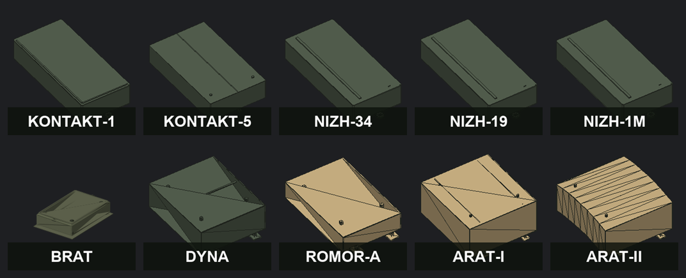
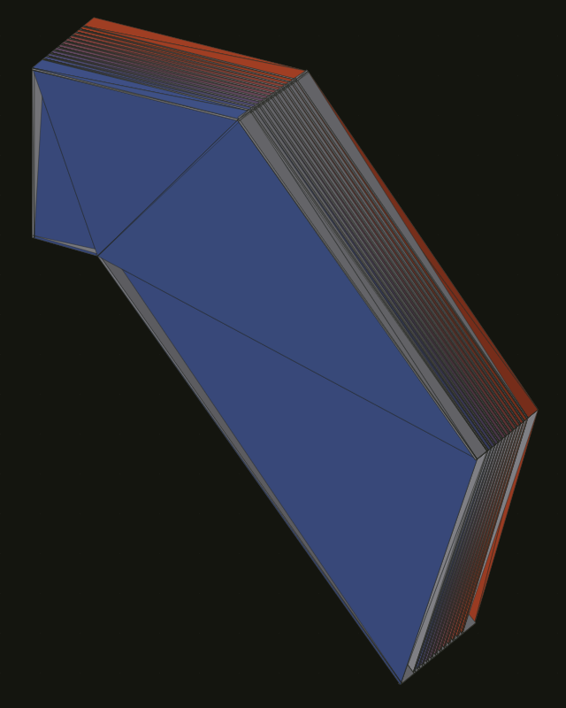
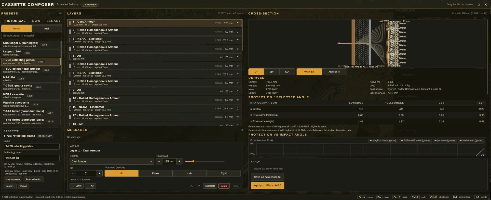
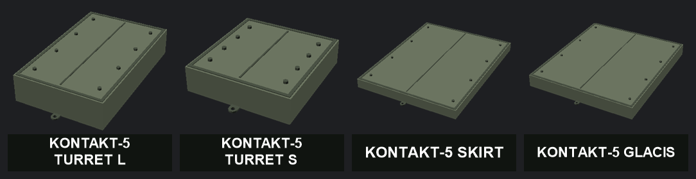
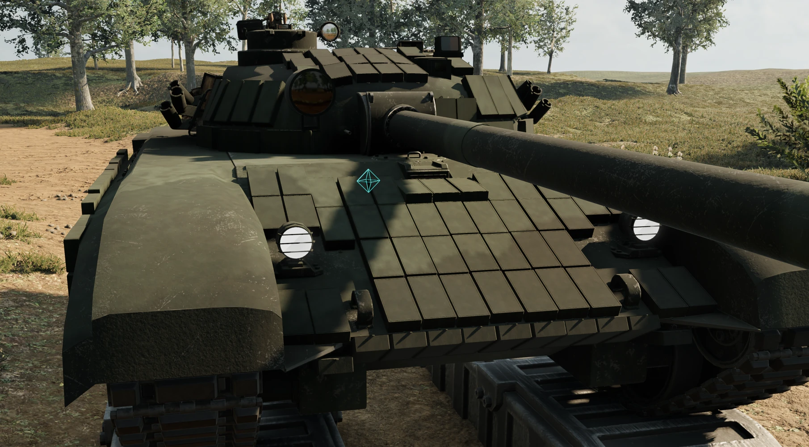
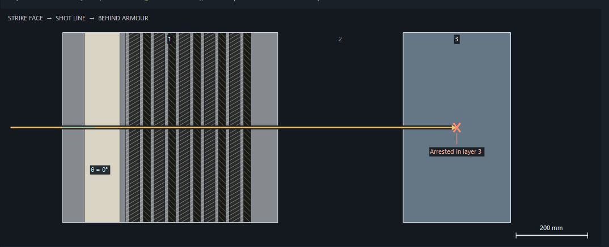
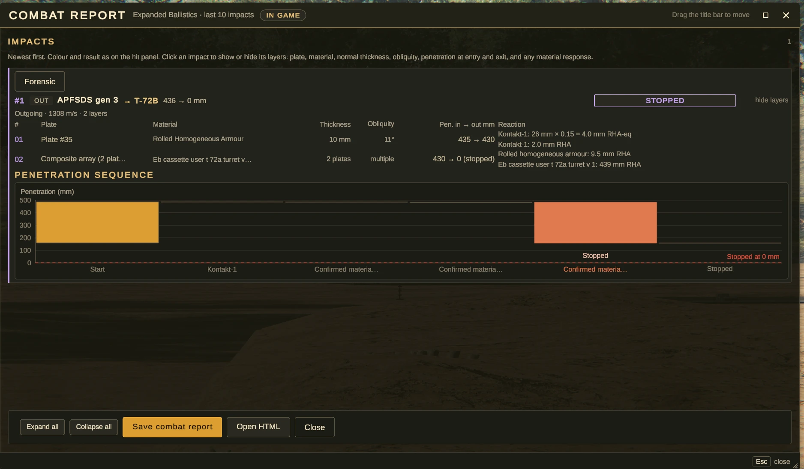

# Sprocket Expanded Ballistics

Expanded Ballistics changes how shells and armour work in Sprocket, so the way you build a tank starts to matter. It adds dated shells, your own shell designs, layered armour, placeable reactive armour, guided missiles and a combat report that shows what happened to each hit.

- Version: 0.22.99
- Plugin GUID: `sprocket.expandedballistics`
- Author: Nero. MIT licence (see `LICENSE`).
- Requires: Sprocket JSON Editor (`sprocket.jsoneditor`, 0.1.5 or later 0.1.x) and Sprocket UI Kit (`sprocket.uikit`, 0.1.7 or later 0.1.x)
- Optional: Sprocket Keybinds (`sprocket.keybinds`) for the key settings. The mod also works with Sprocket Carousel Autoloader (mixed ammunition in its store), Sprocket Oscillating Turret (a sight mount preset for missiles), the Cold War Expansion Pack (see `ARMOUR-RESPONSES.md`) and the third-party Dynamic Gun Sight plugin, if you have it.
- Game version tested: 0.2.56.2

## What it adds

- Shells of the right age: APFSDS (several generations, long and short rod), APCR, APDS, APCBC, APHE, HE, HEAT, tandem HEAT and HESH. Which ones you can use depends on the date and technology of your vehicle.
- A shell editor in the cannon inspector, where you design your own shells (up to 32 profiles).
- A mixed ammunition loadout per cannon, a switch for the shell type in battle, and a HUD that shows the loaded shell and the mix.
- Armour materials and a material editor in the plate-structure panels. Extra materials include wood, rubber, fabric, glass, ceramics and perforated HHS.
- Placeable reactive armour (ERA) in the Reactive armor tab: Kontakt-1, Kontakt-5 (in four sizes), Relikt, Nizh, Duplet, BRAT, ARAT and ROMOR-A.
- A cassette composer for layered passive and reactive armour packages, with presets modelled on named vehicles, a composite side module and composite plates.
- An armour overlay that shows the layers inside a plate, and an armour simulator that previews shots in the designer.
- Guided missiles: a launcher, a guidance sight with a gimbal head and a missile box, all placeable parts.
- A combat report with a cross-section drawing for every hit, and an optional damage feed on the screen.

## How to use it

### Shells

1. Select a cannon in the designer and open its inspector.
2. Open Shell profile and choose a Shell type. The list shows the shells that fit the date and technology of your vehicle.
3. To make your own shell, open the shell editor from the same inspector. It uses the shared JSON editor. Copy one of the existing profiles, give it a new name, change the values and save. A valid profile is available at once.
4. To carry several shell types, set up the ammunition loadout for the cannon design. In battle you switch type with the keys you set (see Settings below), and the HUD shows what is loaded.

<!-- SCREENSHOT: ballistics-shell-editor.png (the shell editor in the cannon inspector) -->

A long APFSDS rod needs room in the loader, so a longer rod is not a free upgrade. If a shell does not fit, shorten the projectile or give the loader more space. An invalid APFSDS design is held back and is not swapped for stock ammunition. For tandem HEAT, choose HEAT impact as the effect, give the shell a precursor penetration above zero and set the main charge separately. Your own profiles are described in [CUSTOM-SHELLS.md](CUSTOM-SHELLS.md).

### Armour materials and layers

1. Select a plate and open its plate-structure panel.
2. Use the material editor to choose a material for each layer and set its thickness.
3. Switch on the armour overlay to see the layers inside the plate.

Wood, rubber, fabric and glass can use your own textures. Put them in the folders under `material-looks\` in the plugin folder (each folder has a short readme).

### Cassette composer

1. Select a plate and open the cassette composer (set a key for it first, see Settings).
2. Choose a preset that follows a real vehicle, or build your own package from passive and reactive layers.
3. Choose what you want to change and press Apply. The composer also has fill tools (Cheek fill (shell), Convert to layers) that fit a package to a turret cheek or to a plate.
4. Show the cassette layers to check the result on the tank.

### Reactive armour

1. Open the Reactive armor tab, next to Structural.
2. Pick a type (Kontakt-1, Kontakt-5, Relikt, Nizh, Duplet, BRAT, ARAT or ROMOR-A) and place it on the hull or turret. Most types now start upright.
3. Fit the blocks where you want them.
4. Go to battle. A block protects you once. When it has gone off, you see its cover blown open.
5. Return to the designer and start again. The blocks are new.

A tandem warhead can set off blocks with its first charge before the main charge arrives, so no guaranteed defeat of ERA by tandem HEAT is claimed. Repeated shots in the armour simulator are previews and do not use up the ERA on your tank.

### Guided missiles

1. Place an ATGM launcher from the part picker and assign a gunner. Put the muzzle outside the armour.
2. Place the guidance sight. It has a gimbal head, and the sight must be linked to every launcher on the same mount.
3. Pick a missile profile for the launcher. SACLOS missiles follow your sight or reticle. MCLOS missiles are steered by hand with the four direction keys, and vehicle controls are blocked while you guide. Top attack missiles need a target lock first (set a key for it). Hold the key on the target for a moment, then fire within 30 seconds.
4. The launcher starts with one ready missile. For more, place a missile box within 2 metres of the launcher's loading point. The box feeds the launcher by default, needs a gunner but no loader, and holds a limited stock. Set the box to use the ammunition you want (or the nearest launcher) in its editor.
5. Gun-launched missiles are fired from an ordinary cannon and use the same guidance.

<!-- SCREENSHOT: ballistics-atgm.png (a tank with the missile launcher, guidance sight and missile box) -->

Computer-controlled gunners lead their target. The details of motor, guidance and top attack are in [ATGM.md](ATGM.md). Two sight options exist for the missile sight view: the black circle can be hidden or can follow the launcher, and the on-screen display can be a digital style (TOW-2B) or an analog one (Swingfire), chosen automatically from the date of the vehicle or set by hand.

### Combat report

1. Play a battle and take some hits.
2. Open the combat report (set a key for it). It lists the newest ten hits.
3. Pick a hit to see the cross-section: where the shell went through, where it stopped and why. Internal modules on the shot line are drawn too.
4. After Play, the last session is also saved as a web page and a data file in the combat-report folder of your config.

The damage feed is a small list on the screen that shows penetrations, damage and ERA that went off. It is off by default.

## Settings

The settings file is `BepInEx\config\sprocket.expandedballistics.cfg`. BepInEx creates it on the first start. Materials have their own file, `sprocket.expandedballistics.materials.cfg`. Edit them with the game closed and restart.

| Section and entry | What it does | Default |
|---|---|---|
| `APFSDS Beta` / `Enabled` | Shell profiles on or off (the section name is old) | true |
| `Ammunition loadout` / `Enabled`, `HUD` | Mixed loadout and its HUD | true, true |
| `ATGM guidance` / `Enabled`, `TopAttackLockSeconds`, `DiagnosticLogging` | Powered guidance, the time to hold a top attack lock (0.1 to 5 seconds), extra log detail | true, 1, false |
| `ATGM Launcher Tests` / `InitialReadyMissile` | The launcher starts with one missile | true |
| `ATGM ammo box` / `AutomaticFeed` | The missile box feeds launchers. Set false to use native loading with a crew loader | true |
| `ATGM Audio` / `Enabled`, `VolumeMultiplier` | Launch sounds on or off, volume from 0 to 2 | true, 1 |
| `Damage feed` / `Enabled`, `Corner` | On-screen damage feed and where it sits | false, right |
| `Protection` / `GroupedBlockMode`, `CompositeProtectionScale` | How grouped armour blocks count, and a scale for composite protection | PerInterval, 1 |
| `Diagnostics` / `Detailed logging` | Extra detail in the BepInEx log. Leave it off for normal play | false |

The mod does not choose keys for you. Open the game's Settings screen, go to Controls and find the mod keybinds panel (the group is called Sprocket Expanded Ballistics). The actions you can bind are Combat report, Next and Previous shell type, Shell type slot 1 to 8, Lock top-attack target, Toggle damage feed in Play, Cycle damage feed corner, Show cassette layers and Cassette composer. This needs Sprocket Keybinds. MCLOS steering uses fixed direction keys that stay in place without Keybinds.

Shell profiles, armour responses, cassette presets, ERA bindings, material reactions, the composite module and the spall settings are JSON files next to the cfg. They are described in [CUSTOM-SHELLS.md](CUSTOM-SHELLS.md) and [ARMOUR-RESPONSES.md](ARMOUR-RESPONSES.md). The files for the game itself (parts, technology, text) go in `Sprocket_Data\StreamingAssets\`. The plugin folder is `BepInEx\plugins\SprocketExpandedBallistics\`, with ERA models and icons in `era-assets\` and texture folders in `material-looks\`. The game's own one-day Coldwar era is skipped in the shell editor era list. The Cold War Expansion Pack supplies the three Cold War eras.

## Known limits

- Tested in earlier 0.22.x builds: the shell editor and ammunition HUD, the gimbal missile sight, player guidance and computer-controlled aiming (reported as accepted), material textures with save and load, and the combat report with the cross-section drawing.
- The composer fill tools were tested on several tanks in November, and fixes are still coming. Shapes outside the supported cases are refused with a message.
- Not yet tested in the game: the newer changes of the last builds. These are the module icons in the cross-section, the four Kontakt-5 sizes, choose-then-Apply in the composer, selected fronts that follow the wall, upright placing of ERA, the two missile sight options and the missile box feeding by default. The renamed pack has not been re-tested.
- Top attack uses a reference profile (`atgm_topattack_test`). No in-game result is recorded for it.
- No tandem defeat of ERA is guaranteed.
- The experimental file `sprocket.expandedballistics.experimental.json` (rod recipes) and the cassette parts that start with `experimental` are still being worked on.
- Protection numbers are gameplay approximations and do not claim to match real armour.

## Building

This is a .NET project (`SprocketExpandedBallistics.csproj`, net6.0). It builds against the game's interop files and the built Sprocket JSON Editor, Keybinds and UI Kit plugins:

`dotnet build SprocketExpandedBallistics.csproj -c Release -p:GameDir=<path to Sprocket folder>`

The two missile launch sounds (`audio\atgm.wav` and `audio\atgm_gun.wav`) are built into the finished DLL and are not in this repository. The author made them with his own Suno account. To build from this repository, supply two PCM16 WAV files of your own with those names. Test fixtures are not included either. See [BUILD.md](BUILD.md).

More documents: [GUIDE.md](GUIDE.md) (install and configuration), [REFERENCE-GUIDE.md](REFERENCE-GUIDE.md) (shell reference, older than parts of the current feature set), [CUSTOM-SHELLS.md](CUSTOM-SHELLS.md), [ARMOUR-RESPONSES.md](ARMOUR-RESPONSES.md), [ATGM.md](ATGM.md), the `docs\` folder and [RELEASE-NOTES.md](RELEASE-NOTES.md).
