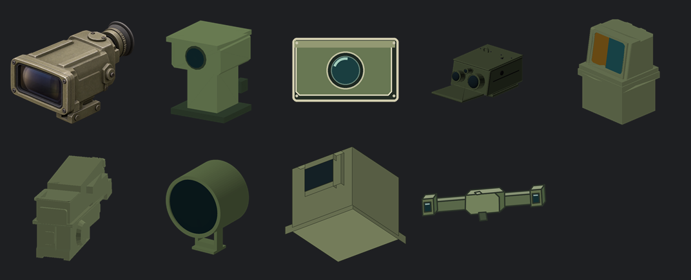

# Sprocket Gun Sights

Gun Sights replaces the stock gunner's sight picture in Sprocket with period sights. Each sight you place gets a country and a historical variant, with its own magnification steps and reticle, from the First World War to the Cold War.

- Version: 0.3.0
- Needs: no other mod
- Works better with: Sprocket Expanded Ballistics, which supplies the loaded and next round shown in the sight
- Game version tested: 0.2.56.2

## What it adds

- 33 sights for Germany (9), the Soviet Union (9), the United States (8) and the United Kingdom (7). Each has its own start date. Examples are the German TZF 12a and EMES 15, the Soviet TSh-2-22 and 1G46, the American M83 and M1 GPS, and the British Centurion gunner's telescope and Swingfire monocular sight.
- Steps of magnification that match the real optics, for example 2.5x and 5x on a dual-optic sight, instead of the smooth stock zoom. The mouse wheel switches between the steps. A field of view of 60 degrees counts as 1x.
- Period reticles drawn at their true angular size. Etched wartime reticles are black and illuminated Cold War reticles are red.
- A tick box "Sight follows gun" on every gunner sight. It decides whether the view moves with the gun barrel or stays fixed along the sight part (see below).
- An optional display of the loaded and next round, when Expanded Ballistics is installed.
- The sight list only offers variants that exist at the vehicle's date. Too-early variants are shown in grey with their start date, and a saved choice is never overwritten. The default sight follows the vehicle's date.

## How to use it

1. Open the vehicle designer and place a gunner sight on your vehicle.
2. Right-click the sight and open the section "Gun sight".
<!-- SCREENSHOT: gunsight-inspector.png (the "Gun sight" section of the inspector with country, variant and the tick box) -->
3. Pick a country first, then a variant. The panel lists the tanks the sight was used on, its optics, and whether the magnification is documented or an estimate.
4. Choose whether the sight follows the gun with the tick box "Sight follows gun". It is on by default.
5. Start a test drive or a battle and look through the sight. Use the mouse wheel to change the magnification step.
<!-- SCREENSHOT: gunsight-view.png (looking through one of the gun sights) -->
6. Save the vehicle. The sight variant and the tick box are stored with it, and a duplicated turret or sight keeps them too.

### Sight follows gun

With the box ticked, the sight uses the game's own view. It aims up and down with the gun, and the game's aim circle stays visible. This is right for a sight on a turret roof, which would otherwise not follow the elevation of the gun.

With the box cleared, the view stays along the sight part itself. This allows missile carriers in the style of the Swingfire, where the sight is aimed independently from a fixed launcher. The box works on every gunner sight, including the sights from Thermal Sight. The guidance sight for guided missiles keeps its own free view and shows no tick box.

## Settings

The settings file is `BepInEx\config\sprocket.gunsights.cfg`. The game creates it on the first start. The mod has no keys, because the zoom steps use the mouse wheel.

| Section / key | Default | What it does |
|---|---|---|
| `General / Enabled` | `true` | Turns the mod on. Restart the game to change it. |
| `General / HideStockReticle` | `true` | Hides the game's own scope reticle while a period sight is shown. |
| `Optics / ReferenceFieldOfView` | `60` | The vertical field of view in degrees that counts as 1x (20 to 100). |
| `Optics / MinimumLinePixels` | `1.6` | The thinnest reticle line on screen (0.8 to 6). |
| `View / DefaultSightFollowsGun` | `true` | The starting value of the tick box for sights that have no saved choice. |
| `View / ShowAmmunition` | `true` | Shows the loaded and next round from Expanded Ballistics. |

## Known limits

- Version 0.3.0 is installed, and the checks for the tick box are still open in the game: a roof sight that aims up and down with the box ticked, the view staying along the part with the box cleared, and the tick box and variant surviving save, reload and duplicate.
- The date limit has not been checked in the game yet: a Coldwar2 vehicle should list the EMES 15 and the M1 GPS in grey with their start dates.
- Earlier notes from 2026-10-30 say that scope calibration, hiding of the stock overlay and save and reload were not yet confirmed in the game.
- A saved sight that is too early for the vehicle keeps its identity. The stock sight is used instead, and one warning is written to the log.
- The renamed pack as a whole has not been re-tested in the game yet.

## Building

The source is a .NET project in `src\` (`SprocketGunSights.csproj`, net6.0). Build it with `dotnet build src\SprocketGunSights.csproj -c Release -p:GameDir=<path to Sprocket folder>`. No other mod is needed to build. The link to Expanded Ballistics is found while the game runs.

Release notes: [CHANGELOG.md](CHANGELOG.md). Tests: `dotnet run --project tests\Tests.csproj -c Release` (sight list and reticle checks). `Audit-Hooks.ps1` checks that every patched game method exists exactly once in the game's interop assemblies.
