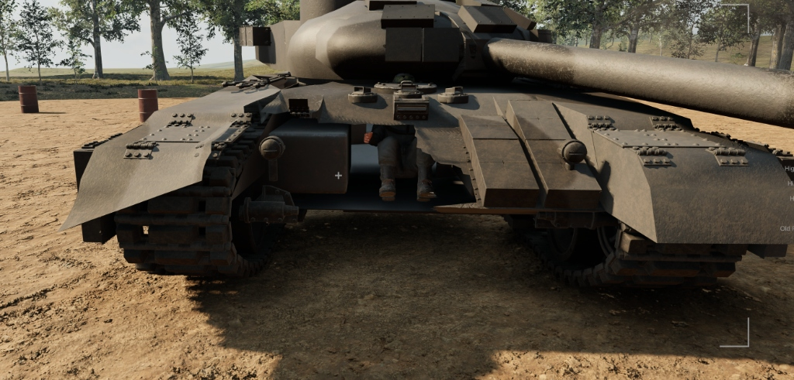
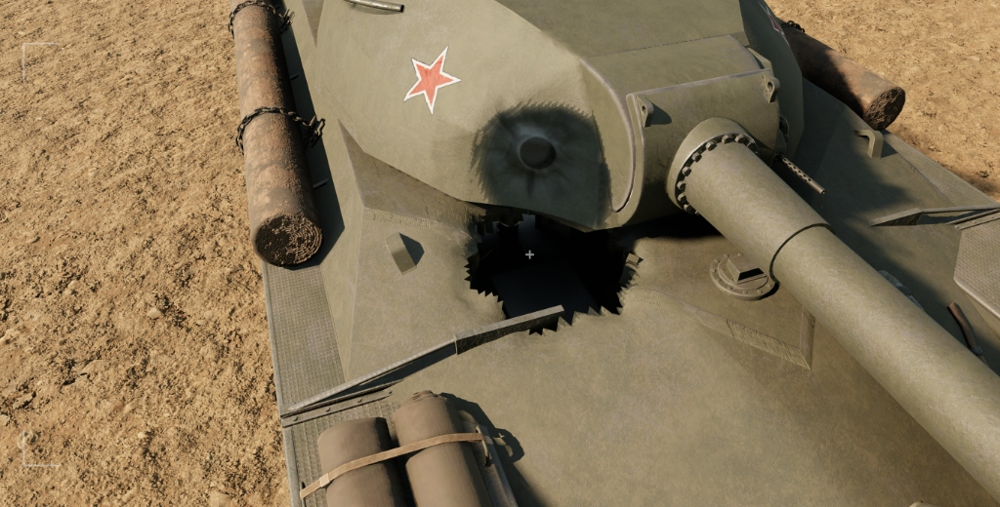
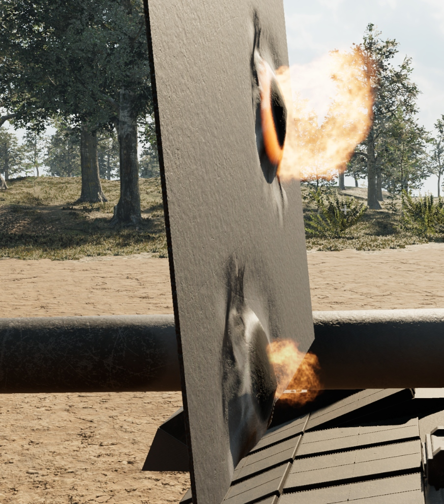
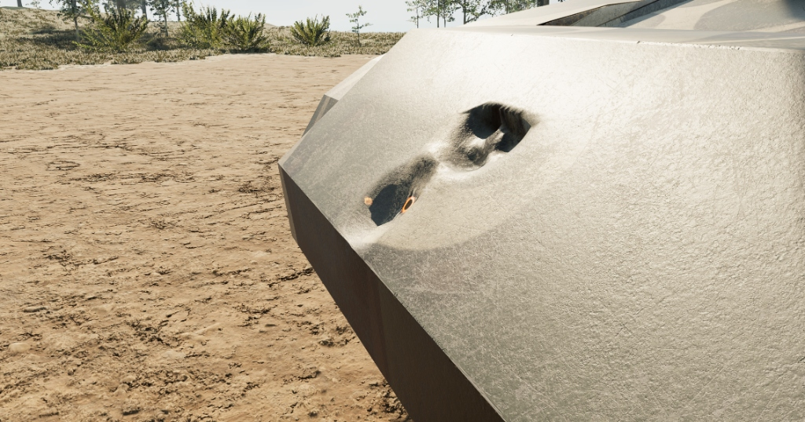
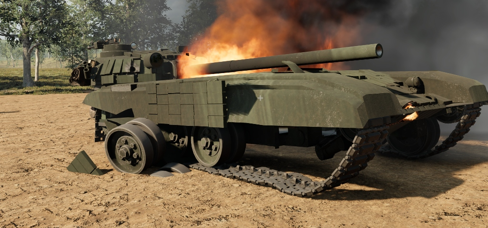

# Sprocket Plate Destruction

Plate Destruction lets armour plates and applique panels take visible and structural battle damage in Sprocket. Plates can dent, tear open, punch blast holes, or break off completely under heavy HE, HESH, HEAT, and blast hits.

- Version: 0.8.4
- Plugin GUID: `nero.sprocket.platedestruction.p0`
- Needs: no other mod
- Game version tested: 0.2.56.2 (updated for the 18 November 2026 GameAssembly)

## What it adds

- **Destructible armour plates and skirts.** Enable destruction on a plate structure in the designer, and it tracks local cell strength based on plate thickness.
- **Visible dents, holes, and torn edges.** High-explosive, HESH, and blast impacts dent plates inward, punch holes through damaged cells, and build solid steel rim walls along torn edges.
- **Per-side mirrored damage.** Mirrored plates (such as left and right side skirts) break independently on the side that was hit, and the broken side is excluded from armour calculations.
- **Inter-plate occlusion and surface-normal blast direction.** Intact outer plates shield plates behind them, and contact blasts push inward along the surface normal.

## How to use it

1. Open the vehicle designer and select a plate structure (such as a side skirt or applique plate).
2. Enable the destruction option in the plate's Destruction section.
3. Start a battle or test drive and fire HE, HESH, or HEAT rounds at the plate. Damaged cells dent, tear, and break off, and subsequent shots pass through the destroyed areas.

## Settings

The settings file is `BepInEx\config\nero.sprocket.platedestruction.p0.cfg`. BepInEx creates it on first start.

- `[Cells] PerCellThickness` (true): computes local strength per cell from the plate's thickness vectors instead of a single plate average.
- `[Dent] RimCapsEnabled` (true): builds solid steel rim walls between outer and inner faces along tears and blast holes.
- `[Effects] HeatBlastScale` (0.35), `MaxNonDestructibleBlastDents` (3), `MaxDentsPerFrame` (2), `DentFrameBudgetMs` (4): controls blast dent scaling and per-frame mesh update budgets.

## Known limits

- Built and verified with 369 automated checks and an ICF check against the 18 November 2026 `GameAssembly.dll`.
- Version 0.8.3 fixes indirect blast orientation and inter-plate occlusion on sloped glacis plates and awaits final in-game confirmation.

## Building

A .NET 6.0 project in this folder (`SprocketPlateDestructionP0.csproj`, .NET SDK 8.0.425). Build with `dotnet build SprocketPlateDestructionP0.csproj -c Release -p:GameDir=<path to Sprocket folder>`. Run `Verify.ps1` for the full build and 369 managed checks. Author: Nero.
