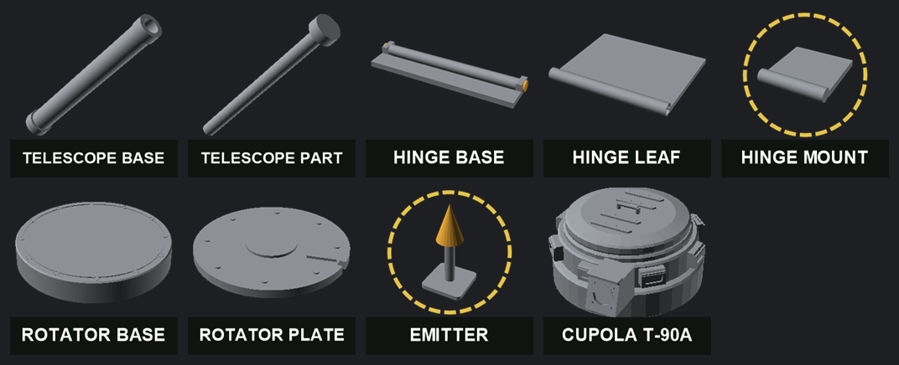
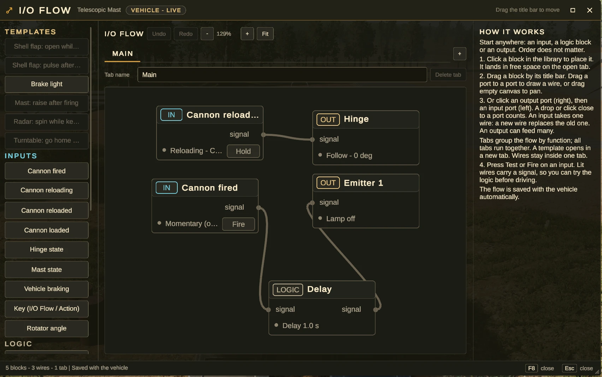
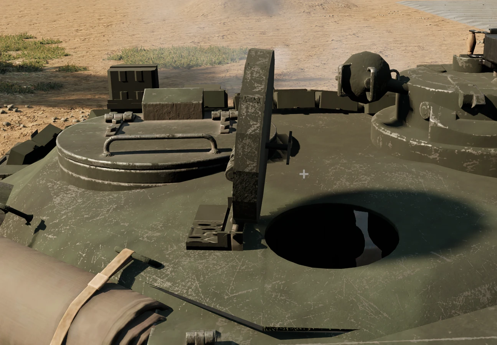

# Sprocket Telescopic Mast

Telescopic Mast adds a sliding sight mast, hinge parts and a turntable to the tank designer. It also adds the I/O Flow editor, a window where you connect events such as "cannon fired" or "brake pressed" to those parts.

- Version: 0.9.9
- Plugin GUID: `sprocket.telescopicmast`
- Requires: Sprocket Keybinds and Sprocket UI Kit (both are part of the pack)
- Works together with: Sprocket Visual Effects (lamps), Sprocket Emitter and Sprocket Cupolas (part icon)
- Game version tested: 0.2.56.2

## What it adds

- **Telescopic Sight Mast, Telescope Base and Telescope Part.** A mast that extends and retracts while you hold a key. The stroke is 1 m at height scale 1 and grows with the scale. The parts are available from vehicle date 1967.01.01.
- **Hinge Base, Hinge Leaf and Hinge Mount.** A leaf swings around a pin, and parts built on the leaf swing along with it. You set the angles and the speed for each hinge. The hinge parts are available at every date.
- **Rotator Base and Rotator Plate.** A turntable for radars and similar parts. It can run, reverse, switch to fast speed and return to a home angle.
- **I/O Flow editor.** A window with inputs, logic blocks and outputs that you wire together. Wires can be dragged, and there are undo and redo buttons.
- **Flow templates.** Ready-made chains: shell flap, brake light, radar spin and mast raise after firing.
- **A connection for other mods.** Visual Effects (lamps), Emitter and Cupolas (part icon) use it to appear in the same editor.

Your flows and hinge settings are saved in the blueprint together with the parts.

## What the I/O Flow editor is

The I/O Flow editor is a canvas of small blocks. On the left is a library with three groups: inputs (things that happen on your tank), logic (blocks that combine or delay signals) and outputs (parts that react). You click a block in the library to place it, then connect blocks by clicking or dragging from one port to another. A signal travels along the wire from the input, through the logic, to the part.

The inputs are cannon fired, reloading, reloaded and loaded, the state of a hinge or mast, vehicle braking, and keys (Action 1 to 4). The logic blocks are AND, OR, NOT, delay, pulse, counter and memory. The outputs are the parts on your tank that can be switched: hinges, masts, rotators, and parts from other mods such as Emitter and the Visual Effects lamps. A part from another mod shows up as an output as soon as you have placed it on the tank.

Other mods plug in by registering their own parts as outputs. That is why a lamp or an emitter you place in the designer can be wired in the same window as your hinge.

## How to use it

### Placing the parts

1. Open the part list in the designer and place a Telescopic Sight Mast, a Hinge Base with a Hinge Leaf, or a Rotator Base with a Rotator Plate. Build other parts on the leaf or the plate, and they move with it.
2. Select a part and use the game's scale tool to change its size. The Rotator Plate stays round: the X value sets the diameter and the Y value sets the height.
3. For a mast, set the keys for raising and lowering. Go to the game's Settings screen, then Controls, then the mod keybinds panel, and look for the "Mast / Raise" and "Mast / Lower" actions. The mod sets no keys itself.

<!-- SCREENSHOT: mast-parts-in-designer.png (the mast, hinge and rotator parts in the designer part list) -->

### Worked example: a flap that opens when the gun fires

This example opens a hinged flap on the turret when the main gun fires, and closes it again when the gun has reloaded. It uses the Hinge Mount as the flap, as a shell-ejection door.

1. Place a Hinge Base on the turret and a Hinge Leaf on it, or a Hinge Mount if you want a flap with a part already on it. Set the closed angle, the open angle and the speed of the hinge.
2. Open the I/O Flow editor. In Settings, under Controls, in the mod keybinds panel, set a key for the action "I/O Flow / Open panel", then press it in the designer.
3. The hinge is listed as an output in the library. Click it to place its block on the canvas.
4. From the Inputs group, click "Cannon fired" to place it. Choose your gun, or any gun in a fire group, in the inspector on the right.
5. Wire "Cannon fired" to the hinge block, or click one of the ready-made templates ("Shell flap") to get a chain with the wires already drawn. A direct "Cannon fired" wire gives only a very short signal. If you want the flap to stay open after the shot, put a Pulse block between them. The Pulse block holds the signal for a time you set, for example 2 seconds. A Delay block in front of it waits first, for example 0.5 seconds.
6. For a flap that is open the whole time the gun is loading, wire "Cannon reloading" straight to the hinge and set the hinge to Follow. The flap then opens when the reload starts and closes when it ends.
7. Click "Test open" and "Test close" in the inspector to see the hinge move. Then save the vehicle, so the flow is stored in the blueprint, and go to the test drive.

The hinge is also how you make hatches that open and close. Build the hatch on a hinge leaf and wire the hinge to a key or to the cannon signals.

Variations on the same pattern:

- Use AND to open the flap only when the gun fired and the brake is held. Use OR to let either a key or the gun open it. Use NOT to turn a signal around, for example to keep a lamp on while the brake is not pressed.
- Use Counter to react to every third shot, and Memory to remember a signal. Memory works like a switch: one signal turns the output on, another turns it off.
- For a brake light, wire "Vehicle braking" to a Visual Effects lamp.
- For ejected casings, wire "Cannon fired" to an Emitter output (see Sprocket Emitter).
- For a radar, wire a held key to the Rotator's `run` port. The Rotator has four ports: `run`, `reverse`, `fast` and `home`.

### Working with the editor

- Tabs above the canvas split a large flow into pages. All tabs run together. Wires stay on one tab.
- Undo and redo are in the toolbar. Fit frames the whole flow. Pan by dragging the empty canvas and zoom with the mouse wheel.
- A part from another mod has a Settings section in the inspector. For an Emitter it holds the item, the speed and the spread.
- A wire is refused with a short message in the status line if it would make a loop or join incompatible ports.

<!-- SCREENSHOT: io-editor-library.png (the library with Inputs, Logic and Outputs, and the inspector on the right) -->

## Settings

The settings file is `BepInEx\config\sprocket.telescopicmast.cfg`.

- `General.Enabled` is true by default.
- `Mechanism.StrokeMetres` is the mast stroke, 1.0 by default (range 0.05 to 1).
- `Mechanism.SpeedMetresPerSecond` is the mast speed, 0.2 by default (range 0.01 to 1).
- `Diagnostics.DetailedLogging` is false by default. Set it to true for a more detailed log.
- `Diagnostics.PassiveAtStartup` is false by default.
- `Keys.Raise` and `Keys.Lower` are only read once, to carry over old key bindings.

The mod sets no default keys. In the game's Settings screen, under Controls, the mod keybinds panel lists "Mast / Raise", "Mast / Lower", "I/O Flow / Open panel" and "I/O Flow / Action 1" to "Action 4". Set the ones you need. The Action keys are the "key" inputs in the editor. The panel position is remembered in `sprocket.uikit.panels.cfg`.

## Known limits

- Tested in game earlier: the mast and its mass fix (0.3.7), the hinge with the I/O panel and the fire, delay and pulse blocks (0.4.1), and the Hinge Mount as a shell-ejector flap (0.5.0). The lamp link and the braking input (0.9.8) and the part settings (0.9.9, seen through the Emitter) also worked in game.
- Not yet tested in game: the flow editor with its undo, the rotator, the smooth meshes and icons, and saving and reloading part settings (0.8.0 to 0.9.9).
- The pack was renamed and has not been re-tested in game since.

## Building

A .NET project in this folder (`SprocketTelescopicMast.csproj`, net6.0). It builds against the game's interop assemblies and the Keybinds and UI Kit DLLs: `dotnet build -c Release -p:GameDir=<path to Sprocket folder>`. Checks: `Verify.ps1` and `tools/Run-Gate.ps1`; unit tests are in `tests/`.

Docs: [GUIDE.md](GUIDE.md) (full description of the hinge and the I/O panel), [IO-API.md](IO-API.md) (for mod makers, mostly Dutch), [CONFIGURATION.md](CONFIGURATION.md) (partly Dutch), [CHANGELOG.md](CHANGELOG.md), [TESTPLAN.md](TESTPLAN.md) (Dutch), [HOOK-REVIEW.md](HOOK-REVIEW.md). Licence: MIT (see the repository LICENSE). Author: Nero.
