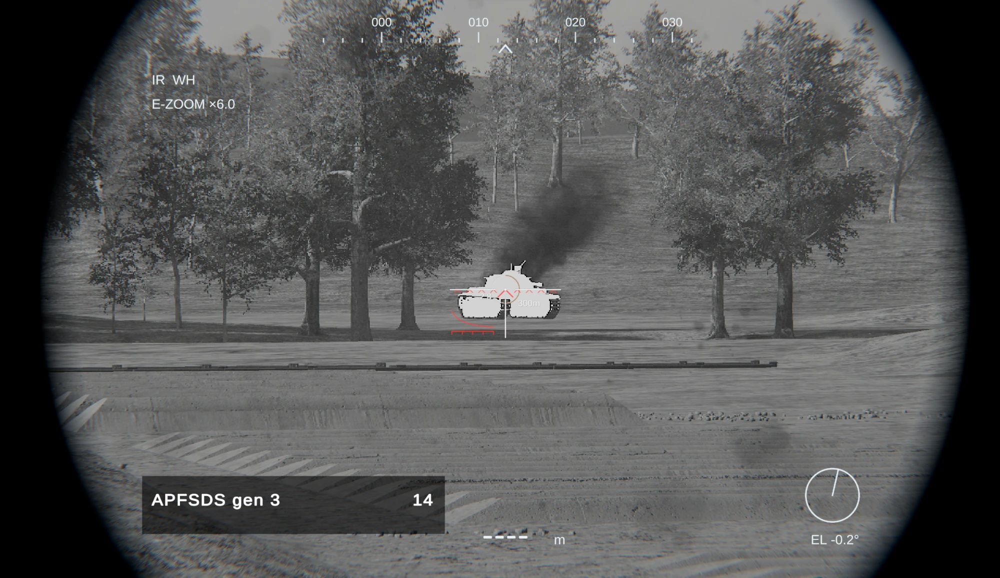
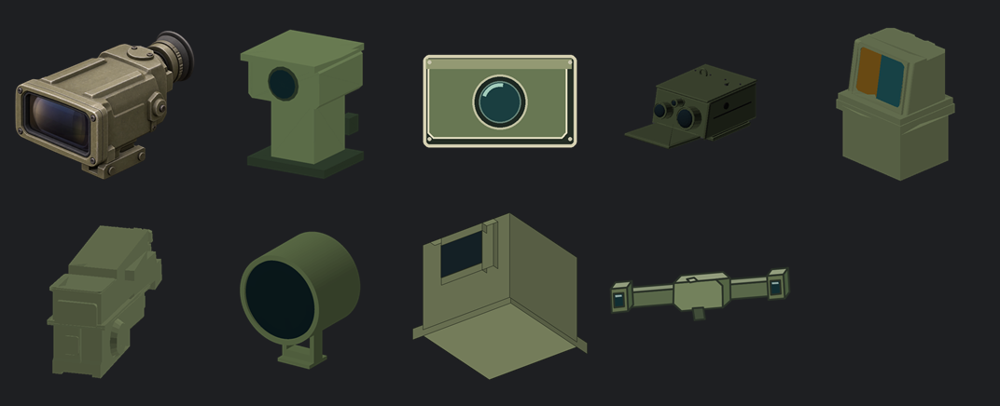

# Sprocket Thermal Sight

Thermal Sight adds night vision to the gunner's sights in Sprocket. The sensors follow the history of the Cold War, from the infrared lamp of the 1950s to modern thermal imaging, and a laser rangefinder helps you aim at distant targets.

- Version: 0.5.4
- Needs: Sprocket Keybinds (version 0.1.6 or newer, below 0.2.0)
- Works better with: Sprocket Expanded Ballistics, which tells the rangefinder and the display which round is loaded
- Game version tested: 0.2.56.2

## What it adds

- Night-vision sensor types, each with its own start date. An active infrared night sight (1950) shows a green picture, but only where your own infrared searchlight lights the scene. Image intensifiers follow with Gen 1 (1962) and Gen 2 (1970). Thermal imaging starts with Gen 1 (1977), then Gen 1 late (1983) and Gen 2 (1992), and goes on to Gen 3 (2004), Gen 3 uncooled (2010) and Gen 3 HD (2015). Thermal sight models 1 to 3 and the Mk3 white-hot and black-hot sights (all 1977) are also in the list.
- A separate on-screen display for each sensor type. The infrared sight has a round eyepiece edge, a cross with range marks and a lamp symbol. The image intensifiers add a range ladder and a gain bar. The thermal types show range, zoom, field of view and polarity, and the later ones add an elevation scale. Gen 3 also has a compass band, a hull and turret symbol with the turret angle, the loaded round and a cooling timer. Gen 3 HD adds a list of the ammunition you carry, with counts, when Expanded Ballistics is installed.
- An infrared searchlight part (from 1950.01.01) for the active infrared sight. Without a searchlight the sight shows green noise and a message that a searchlight is needed.
- A heat model for every vehicle. The engine and exhaust glow, the barrel warms up after you fire, and burning wrecks stay hot while they cool down.
- Rangefinders: a manual laser, an automatic laser that sets the gun's convergence from any active sight, and an optical coincidence rangefinder (from 1943.10.19). A range reading corrects your aim for bullet drop. When Expanded Ballistics is installed, the correction uses the round that is actually loaded.
- A laser box sight (from 1945.09.03), a gunner sight with a built-in manual laser. The TPD-K1 style sight and the laser rangefinder part measure range in the same way.
- A sight console for remote control of linked exterior sights, thermal sight heads, a wall-mounted head, and decorative glass and window parts.
- Sight housings take the vehicle's camouflage paint. Lenses, glass and screens keep their own look.
- Each thermal model adds mass and cost to the vehicle (model 2, for example, adds 22 kg and costs 650).

## How to use it

1. Open the vehicle designer and look in the parts list for the thermal sight models, the infrared searchlight, the laser box sight and the rangefinder parts.
<!-- SCREENSHOT: thermal-parts-list.png (the thermal sight parts in the designer parts list) -->
2. Place a sight on the turret and, if you want ranging, add a laser rangefinder or use a sight with a built-in laser.
3. Right-click an installed sight and pick its sensor type. Types that are too early for the vehicle's date are labelled with the date they become available.
<!-- SCREENSHOT: thermal-profile-menu.png (the right-click menu of a sight with the sensor types) -->
4. For the active infrared sight, also place an IR searchlight on the vehicle.
5. Set your keys in **Settings → Controls → Mod keybinds** under the **Thermal** group:
   - `Toggle` — turns night vision / thermal view on and off
   - `Polarity` — switches between white-hot and black-hot
   - `Measure range` — takes a laser rangefinder reading
   - `Reload profiles` — reloads `thermal-models.json` without restarting
6. In a test drive or battle, aim through the sight and switch the night vision on. Gen 3 sensors that are cooled start with a grey, noisy picture and a countdown of 20 seconds. After that the image is live. A sight stays cooled for the rest of the mission, and only a new vehicle or a new mission starts the cooling again.

7. Press the range key to take a reading. The reading appears on screen for a few seconds, and the aim is corrected for bullet drop.

The picture below shows sights and rangefinders from the pack.

If a thermal sight on a turret roof cannot aim up and down, check the Gun Sights tick box "Sight follows gun" for that sight (see the Gun Sights page).

## Settings

The settings file is `BepInEx\config\sprocket.thermalsight.cfg`. The game creates it on the first start.

| Section / key | Default | What it does |
|---|---|---|
| `General / Enabled` | `true` | Thermal view works on the recognised thermal sight parts. |
| `Rangefinder / Enabled` | `true` | Manual ranging when a laser rangefinder is fitted. |
| `Rangefinder / MaximumDistanceMetres`, `MinimumDistanceMetres` | `4000`, `50` | The distances the rangefinder can measure. |
| `Rangefinder / CooldownSeconds`, `DisplaySeconds` | `3`, `5` | Time between two readings, and how long a reading stays on screen. |
| `Heat / Enabled` | `true` | Heat model on or off. Off gives an even look without hot spots. |
| `Heat / InvertSpotY` | `false` | Flips hot spots upside down if they look mirrored. |
| `Heat / SpotSoftness` | `0.75` | Softness of the edges of engine, exhaust and barrel glow. 0 is hard, 1 is the widest blend. |
| `Heat / HullBaseK` | `3` | A small, even warmth of the whole hull above the surroundings, in kelvin. 0 removes it. |
| `Sensor / CooldownSeconds` | `20` | Cooling time of the cooled Gen 3 sensors. |
| `Hud / Enabled` | `true` | Shows the on-screen display of the sensor. |
| `Hud / DrawReticle` | `true` | Draws the display's own aiming marks. Switch it off if the game's reticle or a Gun Sights reticle is already visible. |
| `Diagnostics / DetailedLogging` | `false` | Extra lines in the log file for troubleshooting. |

The `Heat` section has more values for ambient temperature, warm-up and cool-down times, and range. The sensor types themselves are listed in `BepInEx\plugins\SprocketThermalSight\thermal-models.json`.

## Known limits

- The on-screen displays were seen working in the game, and the heading shown is correct. In that test the uncooled Gen 3 picture was a black blob, the Gen 3 HD view showed two glowing spots and its ammunition list was empty. Version 0.5.2 changes this (engine heat as a box shape, softer edges, a base warmth of the hull, lower contrast for the uncooled sight, a readable ammunition list), and these changes have not been checked in the game yet.
- Not yet checked in the game: the display for each sensor type, cooling only once per sight, the frame rate with Gen 3 HD, double reticles together with Gun Sights or the native reticle, and the sign of the elevation scale.
- Not yet checked in the game: the heat model (hot engine and exhaust seen from the far side, barrel warming after shots), the saved sensor type in a blueprint, the camouflage on all housings, the laser box sight and the rangefinder fixes.
- Streaked and stretched camouflage was reported on the laser rangefinder and the sight console. The fix has not been confirmed yet.
- Range measurement and the camouflage on the IR searchlight were seen working earlier.
- The Gen 3 HD ammunition list needs Expanded Ballistics. Without it, or without a set ammunition load, the list shows "----".
- The renamed pack as a whole has not been re-tested in the game yet.

## Building

The source is a .NET project in `src\` (`SprocketThermalSight.csproj`, net6.0). Build it with `dotnet build src\SprocketThermalSight.csproj -c Release -p:GameDir=<path to Sprocket folder>`. Add `-p:KeybindsDll=<path>` if Sprocket Keybinds is not in `$(GameDir)\BepInEx\plugins\SprocketKeybinds`.

Docs: [GUIDE.md](GUIDE.md) (Dutch), [TEST-GUIDE-NL.md](TEST-GUIDE-NL.md), [HEAT-MAP.md](HEAT-MAP.md), [CHANGELOG.md](CHANGELOG.md). Tests are in `src\tests\Sensor.Tests.csproj` and `ConsoleLink.Tests.csproj`.
