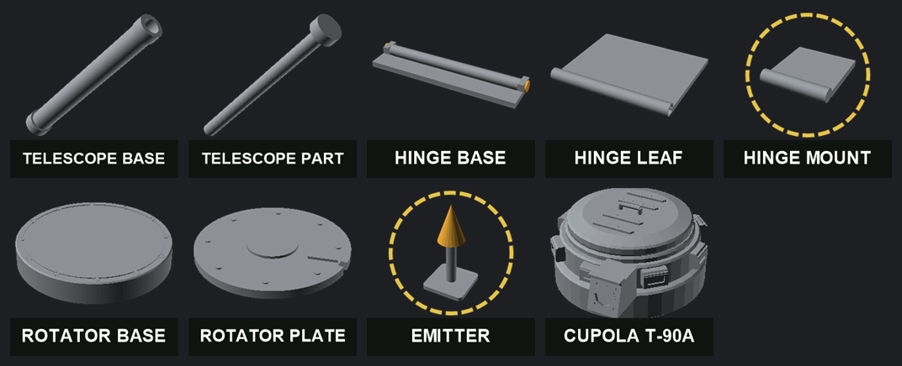
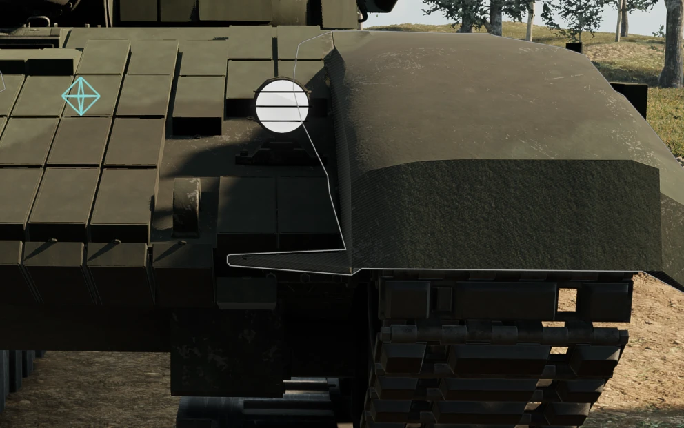

# Sprocket Visual Effects

Visual Effects adds a visual layer to cannon shots: a muzzle blast, smoke puffs lit by the scene, ground dust and a short flash of light. It also adds three tank lamp parts that glow in any colour and light up their surroundings.

- Version: 0.5.4
- Plugin GUID: `sprocket.visualeffects`
- Needs: no other Sprocket mod
- Works together with: Sprocket Telescopic Mast, for lamp settings per lamp and for switching lamps in the I/O Flow editor
- Game version tested: 0.2.56.2

## What it adds

- A muzzle blast for cannons of 50 mm and up (the minimum is adjustable), scaled to the caliber. The game's own flash, sound and damage are left as they are.
- Smoke puffs that react to the light of the scene, and a ring of dust kicked up from the ground.
- A short point-light flash at the muzzle (about 0.12 seconds, no shadows).
- Three lamp parts in Crew / Equipment: LAMP ROUND (the shape of the stock headlight), LAMP RECT and LAMP MARKER (the shape of the stock tail light, the marker at scale 0.6).
- Working lamps: they really light up, and you can switch them on and off from the I/O editor, for example a brake light that comes on when you brake.
- Lamps that behave like stock lamps when you place, mirror, move, rotate and paint them. The glow, halo and light are separate objects that follow the part.

## How to use it

### Muzzle blast and smoke

1. Install the pack. The effect is on by default.
2. Fire a cannon of 50 mm or more in a test drive. You see the blast, the smoke and the dust.
3. To change how it looks, edit the file `BepInEx\config\sprocket.visualeffects.cfg` (see Settings below).

<!-- SCREENSHOT: visual-effects.png (a muzzle blast with smoke and dust in game) -->

### Lamps

1. Open the part list in the designer and find the lamps in Crew / Equipment. Place LAMP ROUND, LAMP RECT or LAMP MARKER like any other part.
2. Right-click a lamp to open its inspector. There is a "Lamp" section with a colour preset or a #RRGGBB colour, the brightness and the range. This section needs the Telescopic Mast, which stores the values per lamp.
3. To switch a lamp with a signal, open the I/O Flow editor of the Telescopic Mast. The lamp is listed as an output. Wire an input to it, for example "Vehicle braking" for a brake light, or a key. The editor is opened with the action "I/O Flow / Open panel". Set a key for it in the game's Settings screen, under Controls, in the mod keybinds panel. The mod itself sets no keys.

<!-- SCREENSHOT: lamp-inspector.png (the Lamp section in the part inspector with colour, brightness and range) -->
<!-- SCREENSHOT: lamp-flow.png (the I/O Flow editor with Vehicle braking wired to a lamp) -->

## Settings

The settings file is `BepInEx\config\sprocket.visualeffects.cfg`. BepInEx creates it at the first start.

- `[Visuals]` has `Enabled` (true), `MinimumCalibreMm` (50), `MaxDistance` (1500), `MuzzleLight` (true), `GroundDust` (true), `WindSpeed` (2.5), `WindDirection` (200) and `FallbackToBillboard` (true). The last one gives a simple flat overlay if the volumetric shader cannot be loaded.
- `[Smoke]` has `SmokeAmount`, `SmokeSize`, `SmokeLifetime`, `SmokeBrightness` and `DustAmount`. All are 1 by default. Use 0 for no smoke or dust.
- `[Lamps]` has `LampDefaultOn` (false), `MaxLamps` (24), `MaxDistance` (250), a fallback colour, intensity and range for each lamp shape, `LensBrightness` and `HaloStrength`. At most 24 lamps cast real light by default. Further lamps only show the glow of the lens.
- `[Diagnostics]` has `DetailedLogging`, false by default. Set it to true for a more detailed log.

The mod has no keys and does not use Sprocket Keybinds. The volumetric shader file `sprocketvfx.bundle` is part of the release and is installed next to the DLL in `BepInEx\plugins\SprocketVisualEffects\`.

## Known limits

- The muzzle overlay was last confirmed in game at version 0.3.0. The smoke tuning of 0.3.1 and later is installed, but no separate result has been reported.
- Earlier lamp versions had problems with placing, mirroring and paint in game. Version 0.4.5 (stock lamp shape, nothing in the part changed) is installed and not yet tested in game.
- The pack was renamed and has not been re-tested in game since.

## Building

A .NET project in this folder (`SprocketVisualEffects.csproj`, .NET SDK 8.0.425 through `global.json`). It builds against the game's BepInEx core and interop assemblies with `-p:GameDir=<path to Sprocket folder>`. `Verify.ps1` builds and runs the offline checks, and `Build-Package.ps1` stages the install layout. See [GUIDE.md](GUIDE.md) for lamp details and the file layout, and [ASSET-PROVENANCE.txt](ASSET-PROVENANCE.txt) for the assets. Needs BepInEx 6 IL2CPP (build 6.0.0-be.788). Author: Nero.
