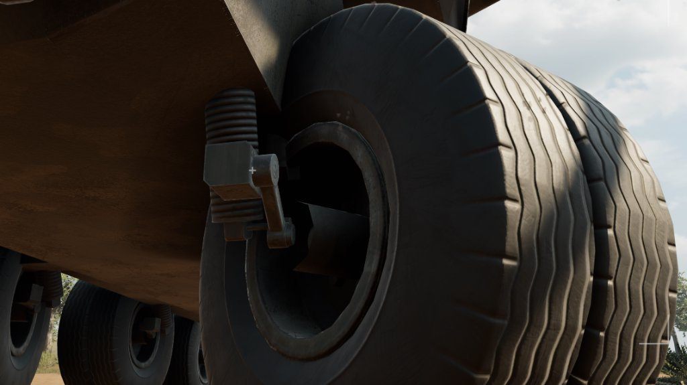
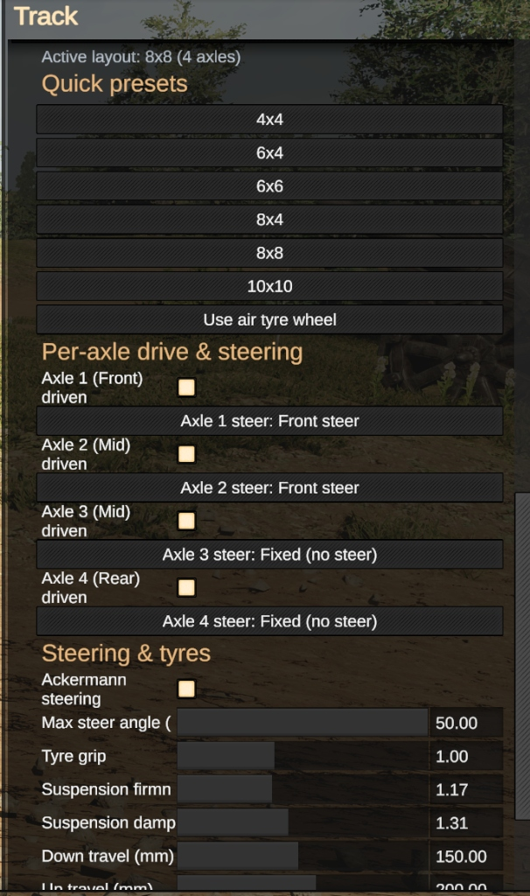

# Sprocket Wheeled Vehicles

Wheeled Vehicles turns any Sprocket chassis into a real wheeled vehicle with per-axle drive and steering, Ackermann steering geometry, pneumatic air-tyre wheels, tuned wheel suspension, and soft rubber tyre rolling audio.

- Version: 0.4.3
- Plugin GUID: `sprocket.wheeledvehicles`
- Needs: no other mod
- Game version tested: 0.2.56.2

## What it adds

- **Quick wheeled presets** in the **Track** inspector: **4x4**, **6x4**, **6x6**, **8x4**, **8x8**, **10x10**, plus **Use air tyre wheel**.
- **Per-axle drive and steering:** toggle **driven** per axle and set each axle's steering mode (**Front steer**, **Rear steer**, or **Fixed (no steer)**).
- **Ackermann steering & suspension tuning:** configurable **Ackermann steering**, **Max steer angle**, **Tyre grip**, **Suspension stiffness**, **Suspension damping**, **Down travel (mm)**, and **Up travel (mm)**.
- **Clean wheeled visuals & audio:** hides the track belt and end sprockets/idlers when wheeled mode is active, and replaces steel track clatter with soft rubber tyre rolling audio.

## How to use it

1. Open the vehicle designer and select the **Track** / running gear section.
2. Pick one of the **Quick presets** (`4x4`, `6x4`, `6x6`, `8x4`, `8x8`, `10x10`) and click **Use air tyre wheel** if you want pneumatic tyres.
3. Fine-tune **Per-axle drive & steering** and **Steering & tyres** (Ackermann steering, max steer angle, tyre grip, suspension firmness/damping, and travel).
4. Start a test drive or battle to drive with real wheeled steering and physics. Settings are saved in the vehicle's `.blueprint`.

## Settings

The settings file is `BepInEx\config\sprocket.wheeledvehicles.cfg`. BepInEx creates it on first start.

- `[General] Enabled` (`true`): enables wheeled vehicle physics and steering for vehicles with wheeled mode enabled.
- `[Audio] EnableTireAudio` (`true`) and `TireAudioVolume` (`0.32`): replaces track clatter with rubber tyre rolling audio.
- `[Diagnostics] DetailedLogging` (`true`): extra trace lines in `BepInEx\LogOutput.log`.

## Building

A .NET 6.0 project in this folder (`SprocketWheeledVehicles.csproj`). Build with `dotnet build SprocketWheeledVehicles.csproj -c Release -p:GameDir=<path to Sprocket folder>`. Needs BepInEx 6 IL2CPP.
